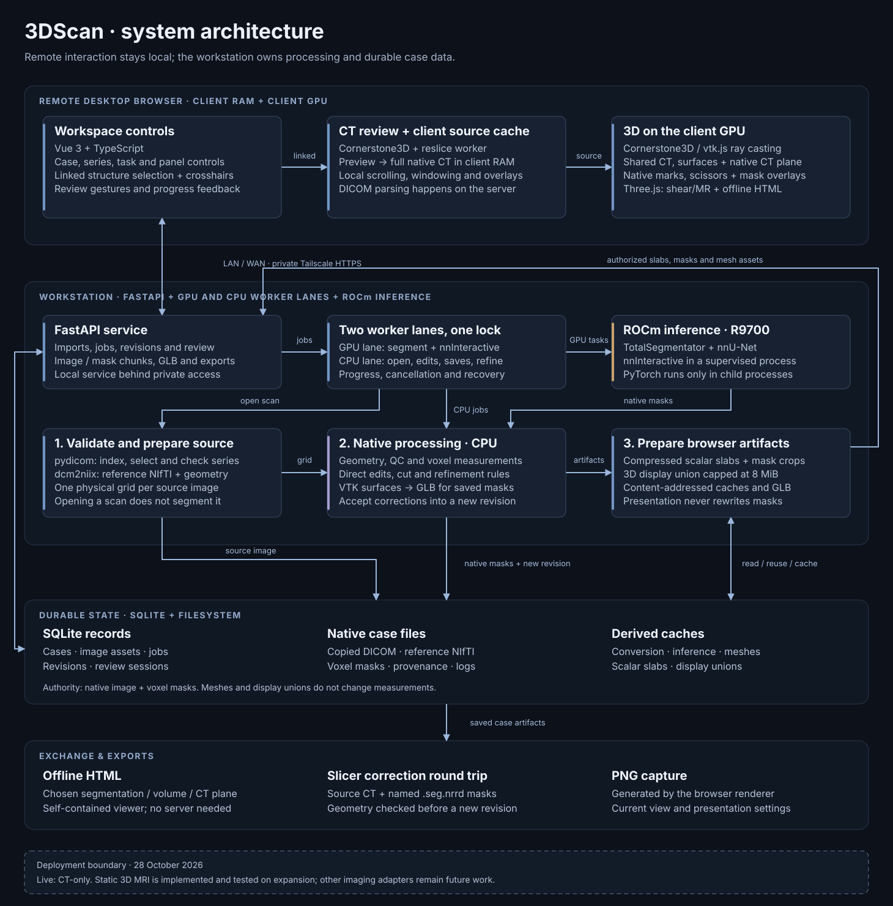

# Architecture

3DScan is a local workbench for reviewing AI segmentation of CT scans. It imports DICOM, runs
TotalSegmentator on request, lets a reader correct the masks by hand or with nnInteractive, keeps an exact
history of every saved change, and shows the result in a browser viewer. It is for research use and
complements a diagnostic viewer rather than replacing one.

This document explains how the software works, for a developer new to the code. [API.md](API.md) is the HTTP
contract and data model. To run the software, see [INSTALL.md](INSTALL.md),
[CONFIGURATION.md](CONFIGURATION.md), [USER_GUIDE.md](USER_GUIDE.md), [ORTHANC.md](ORTHANC.md) and
[DEVELOPMENT.md](DEVELOPMENT.md).



The diagram is generated by `docs/diagrams/render_architecture.py`.

## Design rules

- **Masks are authoritative.** Binary masks on the source image's voxel grid are the only input to
  measurements, edits and exports. Meshes, display unions and overlays are derived from them.
- **Saved work is immutable.** Every change creates a new revision, and earlier revisions keep their masks
  byte for byte. Undo means activating an earlier revision.
- **Geometry is physical.** Positions are patient RAS millimetres with the full affine.
- **The browser renders, the server computes.** The server parses DICOM, runs inference and edits masks. The
  browser renders prepared voxels locally, so scrolling needs no round trip.
- **Expensive work is explicit.** Opening a scan does not segment it, and viewing never starts inference.

## Components

| Where    | Component            | Role                                                                     |
| -------- | -------------------- | ------------------------------------------------------------------------ |
| Server   | API process          | `scan3d serve`: FastAPI, two lane threads, CPU pools, built viewer files |
| Server   | TotalSegmentator     | A subprocess per task, started by the GPU lane                           |
| Server   | nnInteractive worker | A long-lived supervised child process that holds the warm model          |
| Browser  | Main thread          | Vue 3 workspace, Cornerstone3D, vtk.js and Three.js rendering            |
| Browser  | CT worker            | Web Worker that decodes slabs, holds the source and reslices frames      |
| Optional | Orthanc              | A separate DICOM server, reached only over its REST API                  |

The API listens on `127.0.0.1:9010` by default and serves the viewer from `web/dist`. Settings come from a
git-ignored `scan3d.env` file (template: `scan3d.env.example`), read by `scan3d/config.py:load_environment`.
Real environment variables take precedence.

### Code map

| Path                                                                    | Contents                                               |
| ----------------------------------------------------------------------- | ------------------------------------------------------ |
| `scan3d/api.py`, `api_*.py`, `api_models.py`                            | HTTP app, error mapping, routes, request bodies        |
| `scan3d/service.py`, `store.py`, `config.py`, `__main__.py`             | Lanes, revision building, SQLite, settings, the CLI    |
| `scan3d/dicom.py`, `enhanced_mr.py`, `modalities.py`, `image_assets.py` | Series validation, conversion, image identity          |
| `scan3d/segmentation*.py`                                               | TotalSegmentator runs, task catalog, result merging    |
| `scan3d/review.py`, `relationships.py`, `direct_edit.py`, `scissors.py` | Correction sessions and deterministic edits            |
| `scan3d/interactive*.py`                                                | nnInteractive engine, worker, batching, prompts        |
| `scan3d/imaging.py`, `surfaces.py`, `surface_glb.py`                    | Masks, measurements, slice geometry, GLB surfaces      |
| `scan3d/review_volume.py`, `volume_mask_union.py`                       | Volume and frame transport, display unions             |
| `scan3d/agreement.py`, `portable_export.py`, `slicer_io.py`             | Agreement metrics, offline HTML, Slicer exchange       |
| `scan3d/orthanc*.py`, `dicom_*.py`, `osirix_roi*.py`                    | Orthanc connector, DICOM SEG and view, OsiriX writer   |
| `web/src/App.vue`, `web/src/components/`, `web/src/lib/use-*.ts`        | Workspace shell, panels and composables                |
| `web/src/lib/ct-volume.ts`, `ct-worker.ts`                              | Source session and worker                              |
| `web/src/lib/cornerstone-*.ts`, `vtk-*.ts`                              | Slice review, MPR and the native 3D view               |
| `web/src/lib/scene.ts`, `ct-volume-renderer.ts`, `gpu-ct-plane.ts`      | The Three.js renderer                                  |
| `web/src/lib/volume-memory-budget.ts`, `portable-viewer.ts`             | Client memory ledger, offline viewer                   |

## Data flow


**Import.** Files arrive by browser upload, by a path under `SCAN3D_IMPORT_ROOTS`, or from Orthanc.
Originals are copied into the case, and pydicom indexes every series. Unsupported series stay visible with
the reason. Browser imports use a resumable staged upload and become a case only when every declared byte
has arrived.

**Prepare.** A `process` job hashes the selected DICOM bytes and reuses
`converted/<sha256>/reference.nii.gz` if it exists. Otherwise it runs dcm2niix on exactly that series and
checks the output's dimensions, spacing and patient coordinates. The job creates an image-only revision.
Scan-region and timing labels are metadata: they never select frames, change intensities or choose a task.

**Segment.** A `segment` job runs one TotalSegmentator task on the active revision at standard full
resolution, keeping every nonempty output. Its cache key covers the image hash, options, package versions,
wrapper code and device request, so a retry reuses completed inference.

## Store and revision model

All state lives under `SCAN3D_DATA_DIR`:

```text
scan3d.sqlite3           Records, in WAL mode
worker.lock              Held by the process that runs jobs
cases/<case>/
  dicom/                 Originals from uploads and local imports
  sources/<job>/         Originals from Orthanc, with source-import.json
  converted/<sha256>/    Reference NIfTI and conversion log
  inference/<key>/       TotalSegmentator runs and their manifests
  revisions/<id>/        revision.json, model.glb and on-demand exports
  refinements/, corrections/, reviews/, seg-imports/, dicom-exports/
  dicom-view-captures/   Retained 3D view captures, each named by its SHA-256
surface-cache/, review-cache/, analysis-cache/, agreement-cache/, cinematic-cache/
import-uploads/          Staged browser uploads, removed after a day of inactivity
```

SQLite holds JSON records in five tables: `cases`, `image_assets`, `revisions`, `jobs` and
`review_sessions`. A record is committed only after its files are complete. `scan3d backup` takes a database
snapshot first, then copies files, hard-linking anything unchanged since the previous backup. Records store
absolute paths, so restore into the same data directory.

**Image assets** describe one source image and never change: modality, source identifiers, content digest,
geometry, scalar encoding and default presentation. Identity comes from the case, source and content, not
from a path. Child revisions must keep the same source image.

**Revisions** form a tree through `parent_id`. Each records its structures, geometry, QC, surface assets,
review status (`unreviewed`, `reviewed` or `corrected`), the operation that created it, and the pipeline
version and code hash. `revision.json` keeps a readable copy beside the artifacts.

**Structures** are the segments of a revision, with a stable ID (`<task>:<label>`, `custom:<uuid>`,
`dicom_seg:<hash>:<number>` or `synthetic:<name>`), a display name, group, colour, measurements and a
private mask file. Masks are independent, so overlaps are preserved.

**Activation.** A case has one active revision. `Store.commit_revision` publishes a revision, activates it
and completes its job in one SQLite transaction, guarded by the expected active revision.

**Replacing results.** A segmentation run replaces every structure from its task, plus structures from other
tasks with an exactly matching anatomical name, so `total_v3:liver` replaces `total:liver`. There is no
fuzzy matching and no voxel subtraction. Links are remapped to the new IDs, and a conflicting result fails
before anything is published.

## Jobs and lanes

Jobs are rows in SQLite, not messages in a broker. `Service.start` takes an exclusive lock on `worker.lock`
and runs one thread per lane, so one process per data directory executes jobs. A CLI command starts only the
lane its own job needs.

| Lane | Job kinds                                                                                                                                                                           |
| ---- | ----------------------------------------------------------------------------------------------------------------------------------------------------------------------------------- |
| GPU  | `segment`; `review_predict` that runs nnInteractive                                                                                                                                 |
| CPU  | `process`, `orthanc_import`, `orthanc_export`, `orthanc_view_export`, `dicom_seg_import`, `refine`, `correction`, `include_all`, `review_accept`; `review_predict` for direct edits |

A relationship-only Apply also runs on the CPU lane, because it reuses the existing prediction. GPU jobs
never overlap, and CPU work never waits behind a segmentation. Lanes are named for their work, so the GPU
lane still runs when inference uses the CPU device. Review jobs run before queued batch work in each lane,
and queue order breaks ties.

Lanes can finish in either order, and transactional guards decide the outcome: a correction saved while its
case is segmenting stays active, and the segmentation fails at commit. Its inference is cached, so a retry
from the current revision does not rerun the model. Mask analysis and surface preparation share one
service-wide thread budget across both lanes (`SCAN3D_POSTPROCESS_WORKERS`), further limited by available
memory.

**Restart and cancellation.** On startup, running jobs are marked failed as `Interrupted`, and draft
sessions return to an editable state. Queued jobs stay queued, except DICOM SEG and view exports, which fail
locally because a send must be requested explicitly. Cancelling a queued job takes effect immediately; a running job
observes the request at its next check.

## Inference

`SCAN3D_DEVICE` selects the device for both models. `auto` prefers a discrete GPU, then the most reported
memory, and uses the CPU if PyTorch sees no GPU. `gpu` and `gpu:N` require a GPU and fail without one, and `cpu` always uses the
CPU. A GPU request never falls back, and a TotalSegmentator report that shows CPU execution after a GPU
request is rejected. `scripts/check_gpu.py` runs a small 3D convolution and writes a proof file, which
`/api/health` reports without loading PyTorch. `ready` therefore means a verified GPU, and a CPU
installation reports `ready: false` by design.

The API process runs no inference and never imports PyTorch. TotalSegmentator runs in a subprocess, and the
nnInteractive engine and its PyTorch runtime load only in the worker process. At the start of a `segment` job,
the GPU lane runs `python -P -m scan3d.segmentation` in its own session. That short-lived child calls
`segmentation._device_info`, returns the result as JSON and exits, so no GPU runtime stays in the API process.
Cancelling the job stops the child, and a child that gives no answer within 5 minutes fails the job. A server
without AI packages still serves the viewer and direct editing.

### The nnInteractive worker

The first prediction starts `python -P -m scan3d.interactive_worker` in its own session, and the worker
keeps the model and image warm between Apply actions. Parent and child exchange newline-delimited JSON on an
inherited socket pair: `predict`, `cancel` and `shutdown` requests, and `ready`, `progress`, `result` and
`error` events. A separate process means a GPU driver fault fails one job rather than the server, and
process exit is the only way to return all GPU memory.

- **Cancellation** is cooperative first. After 10 seconds the worker's process group is killed.
- **Failure.** A crash, a reported GPU or model failure, or 600 seconds without progress
  (`SCAN3D_NNINTERACTIVE_STALL_SECONDS`) fails that job only. The next prediction starts a fresh worker,
  which replays recorded batches. Cancelled and invalid requests keep the worker.
- **Yielding.** The worker exits before a `segment` job, at shutdown, and if the API process dies.

The model is pinned: nnInteractive 2.6.0 and `nnInteractive_v1.0` at a fixed revision, with the checkpoint
hash verified on load. Requests never download it; that is the job of
`scripts/download_interactive_model.py`.

## Corrections

A review session binds a case, a base revision and one target structure. Its method is fixed when it starts:

- **Direct** edits are deterministic and run on the CPU lane. Paint and erase set voxel centres within a
  physical radius on one native slice. 3D scissors project the target's voxels through a recorded
  orthographic camera and erase inside or outside an outline, through the whole depth of that one segment.
  Edits replay in order from the immutable source mask.
- **nnInteractive** takes include and exclude prompts: points in RAS, and boxes, scribbles and lassos on
  native slices. It runs on the GPU lane and can also refine a whole mask.

Prompts autosave and never run inference. **Apply** queues one job for all pending marks. For nnInteractive,
nearby prompts share one planned model region, distant ones get their own, and oversized ones are tiled, so
no annotation is dropped. Apply boundaries are stored and replayed after undo or a worker restart.

Each Apply produces an immutable candidate, addressed as `review-<session>-<generation>`. The alias works on
the read-only image, mask and frame routes, so the viewer previews it with the transport it already has, and
it never appears in revision history. Direct edits also prepare changed surfaces for 3D preview;
nnInteractive surfaces are built on Save.

**Relationships** define who owns overlapping voxels. Display groups, names and geometric intersection never
authorize a removal. `independent` keeps every other mask, `subregion` names a parent and preserves it, and
`subdivision` names siblings that lose voxels to the target. Parents and descendants are protected, and
exclusivity is never transitive. Changing only the policy reuses the previous prediction with no inference.
[API.md](API.md#segment-relationships) has the rules.

**Save** requires a current candidate that changes masks or relationships, with the base revision still
active. It rechecks the hashes of the image and every affected mask, builds one new revision marked
`corrected`, and commits it with the session in one transaction. The operation record keeps the ordered
prompts, hashes, model identity and per-mask changes. A new segment starts as an empty mask with a
server-assigned `custom:` ID, and only a nonempty candidate can be saved.

## Measurements and surfaces

Each new revision measures its masks, builds missing surfaces and commits. Volume is the nonzero voxel count
times `|det(affine[:3,:3])|`, divided by 1000 for mL. QC messages flag disconnected components and masks
that touch the scan boundary. Measurements are cached by mask bytes, grid and code, and surfaces by mask
bytes and meshing parameters, so a correction rebuilds only what changed.

`surfaces.py` contours masks with VTK through the full affine and simplifies them for display. Display
assets are quantized GLBs, and detailed float32 GLBs are built only on request. GLB files get deterministic
gzip siblings, so the server negotiates a stored file for each response.

## Geometry rules

- **Coordinates.** Every API point, seed and bound is patient RAS millimetres. Arrays keep nibabel's i, j, k
  order, and transport slabs are little-endian and i-fastest.
- **Affine.** Code uses the complete 4×4 matrix. Oblique and reflected grids are normal inputs, and brushes,
  display margins and surface distances use the affine metric, so they stay correct under anisotropy and
  shear.
- **Native drawings.** Drawing prompts use a native axis, a slice index and continuous u, v voxel
  coordinates. A patient-aligned rectangle on an oblique plane is never reinterpreted as a box.
- **Authority.** No display raster, resampled preview or pooled union becomes a source mask or a measurement
  grid.
- **Other frames.** GLB world coordinates are metres, with scene = (−R, S, A) / 1000. Cornerstone and Slicer
  use LPS, with explicit conversions at those boundaries.
- **DICOM exchange.** SEG import and export prove that every source pixel maps to one integer native voxel,
  within 0.05 voxel per axis and 0.05 mm at every slice corner, and never resample.

Sheared affines are handled throughout the geometry code and the viewer. The DICOM importer, however,
refuses a stack whose slices step off the slice normal by more than 0.05 mm, so gantry-tilted CT is rejected
unless it was reconstructed onto a corrected grid. A sheared grid in the viewer uses worker stacks and
Three.js, keeping each frame's original footprint and native index for gesture mapping.

## Viewer

Two viewers share one source and linked crosshairs: slice review (`CTReviewRail.vue`,
`CornerstoneCTView.vue`, `CornerstoneMPRView.vue`) and 3D (`ModelViewport.vue`,
`CornerstoneVolumeView.vue`).

### Source transport

The browser never parses DICOM. `LocalCTSession` fetches a descriptor from `image-volume` and hands its gzip
chunks to the CT worker, which holds one CPU copy. A preview of at most 192 voxels per dimension loads first
and makes every plane available. The full volume then caches in the background and replaces it once
validated. Chunks are immutable, so a warm browser cache avoids the transfer. The worker's CT budget is 512
MiB, or 128 MiB on a device reporting 2 GiB of RAM or less. Selected masks arrive as cropped binary volumes,
within 64 MiB for preview and 192 MiB for full.

While the full volume loads, the viewer shows resliced preview frames and requests an exact frame through
`review-frame` after 120 ms of idle. Window and level stay on the client, and preview samples never supply
the exact HU readout.

### Slice review and MPR

Cornerstone3D is the only 2D renderer, and it requires WebGL. After full preload, an orthogonal source loads
once into a shared ImageVolume serving three orthographic viewports. Slabs reuse the worker's copy, and
native order, reflection, spacing and per-slice origins are preserved.

Crosshairs translate and rotate the planes. MIP and MinIP project the CT through a slab of up to 200 mm,
while overlays show the centre slice and drawing pauses. Masks are independent binary labelmaps, so overlaps
survive. Preview, sheared and over-budget sources use stack viewports fed by worker-resliced frames, with
overlays drawn on a canvas.

### Native 3D: Cornerstone3D and vtk.js

Full orthogonal CT defaults to a `VOLUME_3D` viewport in Cornerstone's rendering engine, using vtk.js ray
casting. `acquireCornerstoneSource` gives each CT session one image volume, texture, context and memory
reservation. MPR and 3D are independent consumers: either can open first, and closing one keeps the other
without a download. The last consumer releases the native resources. This sharing is why the view uses
Cornerstone's engine: a separate 3D renderer would hold a second GPU copy of the CT beside MPR.

- **CT plane.** One exact native slice, in a raster of at most 8 MiB, is reused for window and level.
- **Surfaces.** Enabled structures load from quantized GLBs into vtk actors, three at a time. A revision
  change swaps them atomically and hides old actors until replacements succeed. With CT visible, surfaces
  are opaque for correct depth composition.
- **Mask to segmentation.** The server builds one OR union of the chosen structures, cropped to their
  bounds, with an optional physical margin of 0–5 mm. Crops above 8 MiB are reduced by foreground-centre
  occupancy pooling, which keeps thin structures but can grow a boundary by a grid cell. The union gates
  primary, scattering and ambient-occlusion opacity. An empty, loading or failed mask hides CT rather than
  showing the wrong tissue.
- **Color segments.** A label union stores which structure covers each crop voxel, largest first so
  contained anatomy stays visible. A shader hook tints the transfer-function colour before lighting, leaving
  opacity and shading to the CT. The native view colours up to 64 structures.
- **Lighting.** Preset, Standard, Cinematic and Ambient occlusion modes expose vtk.js scattering and ambient
  occlusion. A manual light can follow the camera or stay fixed in patient space.

Masking and colouring extend Cornerstone's streaming volume mapper through a factory local to one actor, so
MPR actors keep their original mappers. That bridge imports one unexported Cornerstone module and patches
exact shader anchors. It checks the installed versions (Cornerstone3D 5.13.1, vtk.js 36.4.1) and throws on a
mismatch, so a dependency upgrade fails visibly.

### Three.js renderer

Three.js loads lazily, for sheared grids, MRI and offline HTML.
`AnatomyScene` owns one WebGL context, the surfaces, a native CT plane and the prompt markers. Its ray
marcher applies opacity correction in physical millimetres. Transparent surfaces use weighted blended
order-independent transparency, and a combined volume and surface view peels fragments and integrates CT
between their depths. Its CT and mask atlas have a 512 MiB texture limit.

Appearances in both renderers come from the 31 default 3D Slicer presets, plus a Cinematic heart preset that
follows measured HU. The renderers differ from each other and from 3D Slicer. vtk.js draws one linear
gradient-opacity ramp, so Cornerstone uses each preset's first two points. That is exact for the 30 presets in
the menu, which stay flat past those points. The gradient opacity of `uCT-Skull` falls and rises again, so the
app does not offer it, exports refuse it, and Cornerstone refuses a restored view that names it rather than
draw it differently.

### Memory budget

`volume-memory-budget.ts` keeps one reservation ledger for all viewers: 3 GiB on desktop and 256 MiB on
devices reporting 4 GiB of RAM or less. Reservations are made before allocating. The worker's source is
charged once per immutable identity, and each renderer's CPU and GPU copies are charged separately, with
conservative GPU estimates. Mask staging counts current and replacement copies until a swap commits. These
are allocation estimates, not measurements of driver memory.

Hidden views abort uploads and release their GPU resources and reservations, while the worker source stays
resident until its session closes. A request over the limit fails before allocating, and the viewer explains
it and offers Retry. Slice navigation falls back to stack viewports.

### Correction in the viewer

Orthogonal CT review stays in the native viewport. Surface points use CPU cell picking on the locked target
only. Drawing happens on an exact native plane built from `review-frame` data, in one bounded RGBA texture.
Prompts have the same form whichever renderer produced them.

A drawing gets native axis and index authority only when the whole viewport is proven to lie on one integer
source plane. Source, target, tool, camera or slice changes cancel an active gesture, and marking requires a
settled full-resolution frame.

### Failure and offline use

Source, renderer and overlay errors each have their own Retry. A renderer Retry rebuilds from the resident
session, without a CT download.

**Offline HTML** is a self-contained viewer with no Cornerstone code. The reader chooses any of
segmentation, CT volume and CT plane, and only that data is embedded. The page makes no network requests,
and manifests use a field allowlist. The app builds the snapshot from its view state and converts the
Cornerstone camera, so exporting loads no Three.js in the app. The exported page renders with Three.js, so
native lighting and segment colouring are not exported.

## Orthanc connector

The connector is optional and off unless `SCAN3D_ORTHANC_URL` is set. 3DScan is only a REST client: it runs
no DICOM listener, and Orthanc owns its own archive and setup. See [ORTHANC.md](ORTHANC.md).

- **Browsing.** The backend holds the credentials and returns bounded summaries. Identity fields travel in
  POST bodies, and connector responses use `Cache-Control: no-store`.
- **Importing.** Choosing a series binds an immutable snapshot of its UIDs, file identities and sizes. A CPU
  job downloads it into staging, rechecks the archive, and verifies hashes and DICOM identities
  independently before publishing the originals. Orthanc's stability flag only means no recent arrivals, so
  a series with an unknown expected count imports with a warning. Interrupted transfers are never resumed
  automatically, and import does not convert or segment.
- **Launching.** An Orthanc Explorer 2 button can open a series through URL fragment fields. The launch
  route finds a matching import but creates nothing.

## DICOM SEG and other exchange

**SEG export** turns chosen structures of a saved revision into one binary SEG instance on the CPU lane,
with overlaps preserved. Masks are processed one at a time, so memory stays bounded. A manifest pins the
SEG, mask and reference hashes before any upload, and Orthanc keeps and sends the same bytes to allowlisted
modality IDs. Export never changes a revision. It requires an original classic CT imported through the
configured archive. A ranked export claims voxels in rank order against one boolean grid, so each voxel
stays in one structure. It is a derived copy for viewers: the saved masks remain the authority.

**View export** turns one capture of the 3D view into a Secondary Capture series in the source study, on
the CPU lane. `orthanc_view_exports.py` subclasses the SEG manager, so both share queuing, retries, receipts
and delivery uncertainty, and each lists only its own jobs. It needs no masks, so it works on a CT-only
revision. The PNG is retained by content, apart from the export directory, because a retry can move to a new
directory. Patient and study elements are copied exactly from the source headers. Orthanc reports success
wherever an instance lands, so the export compares the patient identity it will file under before upload,
and checks the study Orthanc reports before it saves a receipt or sends. The instance is a picture, with no
frame of reference, and nothing measures from it.

**SEG import** takes a local upload and needs no Orthanc connection. It appends segments as a new unreviewed
revision after exact source-identity and native-grid checks. Anything that would need thresholding or
resampling is refused.

**Slicer exchange** exports a ZIP with the reference image, `segmentation.seg.nrrd` and a stable ID mapping,
and imports corrected segmentations after geometry and identity checks. `osirix_roi.py` is a standalone
writer for native OsiriX brush ROIs, with no API route or UI.

## Modalities

`SCAN3D_MODALITIES` lists what an installation offers, and the default is CT. Stored series of a disabled
modality read as unsupported until it is enabled. CT import accepts classic single-frame CT storage with one
acquisition, phase and reconstruction per series.

`SCAN3D_MODALITIES=CT,MR` adds an experimental adapter for one homogeneous static anatomical MR series or
one complete static Enhanced MR instance. MRI values are `signal` units, never HU, and its task catalog is
separate. MR conversion uses `dcm2niix -m n -p n -l o -x i`, so sequences are never force-merged.
`scan3d/modalities.py` holds the adapter registry.

## Security boundaries

There is no sign-in, so the server binds to loopback and logs a warning for any other address.
`SCAN3D_ALLOWED_HOSTS` restricts `Host` headers, and mutations from another browser origin are refused.
Files are written with umask 077, and public records omit filesystem paths.

Scans stay on the server. Outbound calls are limited to the configured Orthanc, license validation when a
TotalSegmentator key is saved, and model downloads: TotalSegmentator fetches missing weights on first use,
and the nnInteractive model has an explicit script.

## Known limitations

- There is no sign-in, user model or audit trail, so saved work records no reviewer identity. Anything that
  can reach the port can read every case.
- One process per data directory runs jobs, one job per lane. SQLite and local files are the only store, so
  the service does not scale out. It runs on Linux only.
- Review status belongs to a revision, not to a structure. CPU inference is much slower than a GPU.
- CT import refuses gantry-tilted, enhanced or multi-frame, and localizer series. MRI is experimental and
  off by default, and other modalities have no adapter.
- 2D review requires WebGL, with no fallback renderer.
- Client memory limits are conservative estimates. A large CT with MPR and all surfaces can exceed them, and
  closing a view frees capacity.
- The native masking bridge depends on the exact pinned Cornerstone3D and vtk.js versions.
- Native 3D shows opaque surfaces when CT is visible, and surfaces cast no shadows into the volume.
- SEG export needs an original classic CT imported through Orthanc. SEG import is limited to binary,
  uncompressed segmentations on the exact native grid.
- The nnInteractive checkpoint is licensed CC BY-NC-SA 4.0 (noncommercial), and some TotalSegmentator tasks
  need a separate license.
- 3DScan has not been evaluated for clinical accuracy and is not a medical device.
