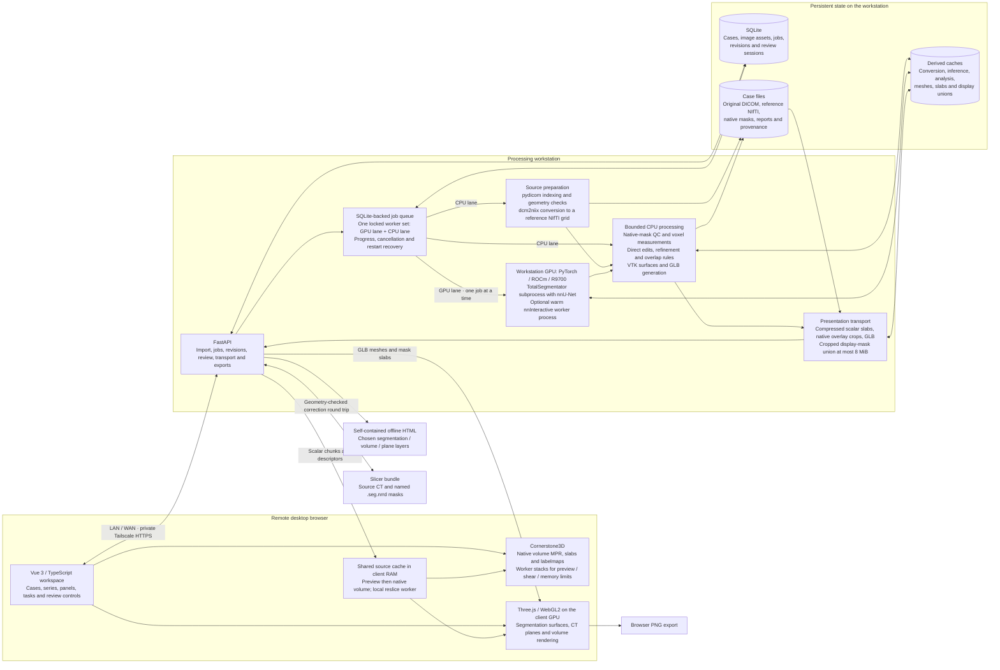
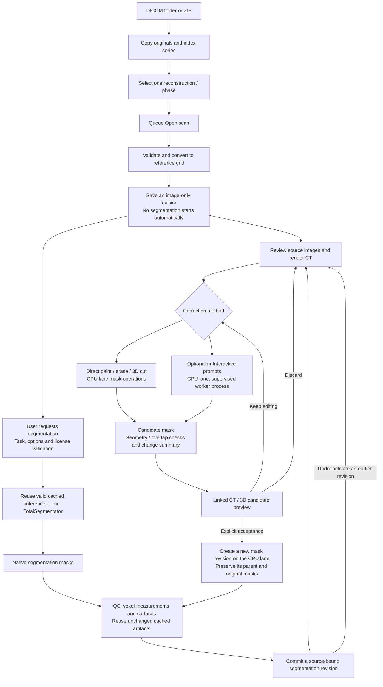
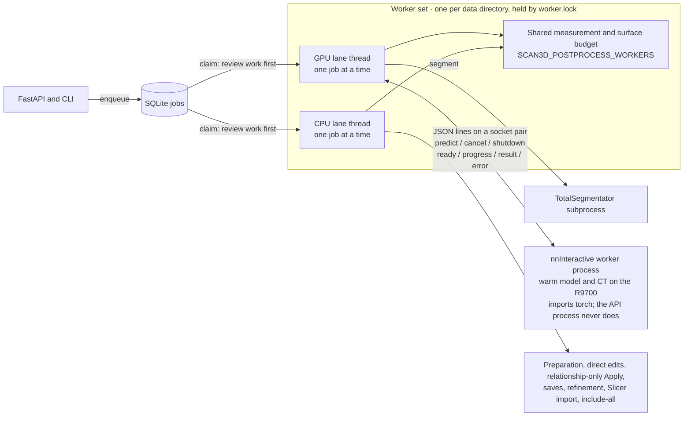

# 3DScan architecture

3DScan is an AI-assisted analysis workbench for radiologists that complements
viewers such as OsiriX. A high-quality, responsive viewer supports testing,
comparing, correcting and using segmentation and other analysis tools.

This describes the implementation as of **27 October 2026**. The live service is
the CT-only `ct-hardening-20261027` release, where `SCAN3D_MODALITIES=CT` keeps
MRI turned off. Static 3D MRI is implemented and tested on `expansion`; X-ray, mammography, ultrasound, catheter
angiography and cine ingestion still need their own adapters. Modality enum
values alone do not enable those workflows.

Future clinic integration must account for the user's planned Orthanc-based
replacement of an existing imaging workflow. The proposed boundaries and open
questions are recorded in [CLINIC_INTEGRATION.md](./CLINIC_INTEGRATION.md);
they are separate from the implemented system shown below.

The editable Mermaid flows are below. The standalone overview is also available
as [SVG](./diagrams/architecture.svg) and [PNG](./diagrams/architecture.png);
its layout source is [render_architecture.py](./diagrams/render_architecture.py).

## System boundaries

The workstation parses DICOM; Cornerstone receives prepared reference-grid
voxels, never raw DICOM. After full preload, one Cornerstone ImageVolume and
RenderingEngine serve three orthographic viewports. Native i-fastest slices
arrive through bounded slabs from the existing worker. Identity-scaled integer
samples remain integer; other source scalars are scaled once to float32. Slice
origins and all affine direction signs are preserved, including reflected grids.

Crosshairs support translation and oblique rotation. MIP/MinIP affect only the
source CT actor; independent binary labelmaps show the centre plane. Native
review resets orientation to exact source-index planes and disables rotation
and slabs while drawing. Camera projections supply patient RAS gesture positions;
only a proven integer native plane can authorize axis/index/u/v drawings.

Preview, sheared and over-budget sources retain Cornerstone worker-resliced
stacks and exact scalar/binary `/review-frame` transport. A sheared native frame
gets an orthogonal display raster within the same patient plane, with its original
footprint and native index retained for inverse-affine gesture mapping. No
resampled display grid becomes a source mask or measurement grid.

A shared reservation budget charges the worker source once per immutable identity
and each visible renderer's CPU/GPU copies separately. The default is 2 GiB on
desktop and 256 MiB on explicitly low-memory devices; float32 source-copy and GPU
estimates are conservative. Mask staging includes current and replacement copies.
Hidden 2D/3D views abort uploads and release their owned GPU resources and
reservations, retaining the App-owned worker for reuse. These are allocation
estimates, not measurements of driver VRAM. A volume that cannot fit uses the
existing Cornerstone stack path with an explanation and Retry.

Source download, renderer and overlay errors have distinct Retry paths. An MPR
context failure releases the shared engine, labelmaps, tools and image cache
before rebuilding from the resident CT. Candidate changes replace mask display
copies while retaining the source volume and camera. The Three.js scene still
owns 3D volume/surface composition, picking and portable export. Warm navigation,
windowing and camera changes use resident client data. The client browser GPU
handles viewing; the workstation ROCm GPU handles model inference.

An isolated synthetic [3D renderer comparison](VOLUME_RENDERING_COMPARISON.md)
tests direct vtk.js and a fourth Cornerstone volume viewport. The latter reuses
the MPR ImageVolume, CT texture and WebGL context. These adapters are outside
both application build entries; they do not replace Three.js scene composition
or portable export. Direct vtk's current worker bridge assembles another CPU
scalar buffer and owns a separate GPU texture.

Native reference images and masks remain authoritative for editing and
measurements. GLB meshes and the bounded 3D mask union are derived presentation
artifacts. Their simplification never changes mask-derived volumes.

## Scan and correction lifecycle

## Job lanes and the nnInteractive worker

Queued processing runs on two background threads backed by SQLite and one
filesystem process lock, not an external broker. The GPU lane runs
TotalSegmentator and nnInteractive predictions strictly one at a time. The CPU
lane runs everything that never touches the GPU, so direct edits and saves no
longer wait behind a segmentation. Each lane takes review work before queued
batch work. Transactional active-revision and generation guards, not queue
order, decide between jobs that finish on different lanes.

nnInteractive runs in a supervised child process that the GPU lane starts on
demand, keeping its model warm between Apply batches. A crash, hang or GPU
failure fails only that job; the next request starts a fresh child. Ignored
cancellation is enforced by killing the child's process group after a grace
period. Before TotalSegmentator runs, the child exits to return all of its VRAM.

Dense mask analysis and surface preparation use bounded CPU thread pools that
share one service-wide budget across both lanes. Completed stages remain
reusable after cancellation or restart.

## Code map

- [API and transport](../scan3d/api.py), [job lanes, dispatch and revision building](../scan3d/service.py), [SQLite, claims and activation](../scan3d/store.py).
- [nnInteractive engine](../scan3d/interactive.py) and its [supervised worker process](../scan3d/interactive_worker.py).
- [DICOM preparation](../scan3d/dicom.py), [inference](../scan3d/segmentation.py), [native operations and measurements](../scan3d/imaging.py), [CPU surfaces](../scan3d/surfaces.py).
- [Candidate review and acceptance](../scan3d/review.py), [scalar/mask transport](../scan3d/review_volume.py), [display union](../scan3d/volume_mask_union.py).
- [Browser source worker](../web/src/lib/ct-volume.ts), [Cornerstone stack adapter](../web/src/lib/cornerstone-runtime.ts), [native MPR](../web/src/lib/cornerstone-mpr.ts), [shared memory budget](../web/src/lib/volume-memory-budget.ts), [3D scene](../web/src/lib/scene.ts), [volume renderer](../web/src/lib/ct-volume-renderer.ts).
- [Portable export](../scan3d/portable_export.py), [embedded offline data](../web/src/lib/portable-viewer.ts), [MRI expansion boundaries](./EXPANSION_FOUNDATION.md).
