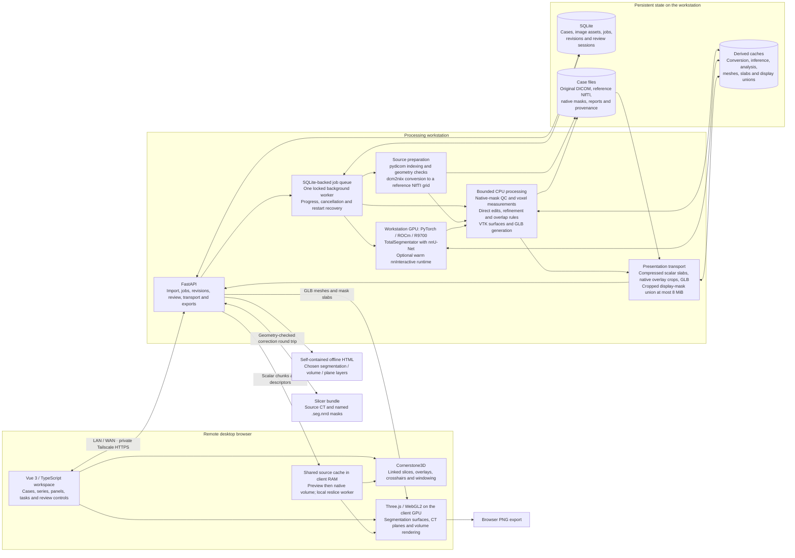
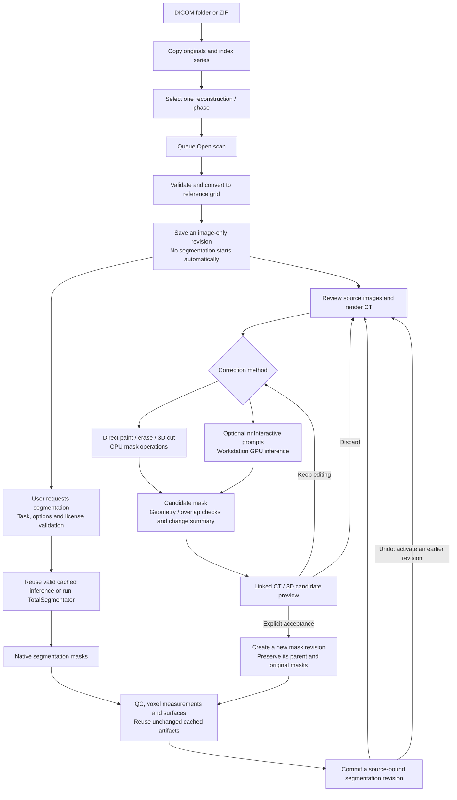

# 3DScan architecture

3DScan is an AI-assisted analysis workbench for radiologists that complements
viewers such as OsiriX. A high-quality, responsive viewer supports testing,
comparing, correcting and using segmentation and other analysis tools.

This describes the implementation as of **27 October 2026**. The live service is
the CT-only `ct-appearance-20261027` release. Static 3D MRI is implemented and
tested separately on `expansion`; X-ray, mammography, ultrasound, catheter
angiography and cine ingestion still need their own adapters. Modality enum
values alone do not enable those workflows.

Future clinic integration must account for the user's planned Orthanc-based
replacement of an existing imaging workflow. The proposed boundaries and open
questions are recorded in [CLINIC_INTEGRATION.md](./CLINIC_INTEGRATION.md);
they are separate from the implemented system shown below.

The editable Mermaid flows are below. The standalone overview is also available
as [SVG](./diagrams/architecture.svg) and [PNG](./diagrams/architecture.png);
its layout source is [render_architecture.py](./diagrams/render_architecture.py).

## System boundaries

The workstation parses DICOM; Cornerstone receives prepared image frames rather
than raw DICOM in this pipeline. The browser GPU renders the remote viewer;
the workstation ROCm GPU runs model inference. Warm navigation, windowing and
camera changes use resident client data.

Native reference images and masks remain authoritative for editing and
measurements. GLB meshes and the bounded 3D mask union are derived presentation
artifacts. Their simplification never changes mask-derived volumes.

## Scan and correction lifecycle

The worker serializes queued processing; it is a background thread backed by
SQLite and a filesystem process lock, not an external broker. Dense mask
analysis and surface preparation use a bounded CPU thread pool internally.
Completed stages remain reusable after cancellation or restart.

## Code map

- [API and transport](../scan3d/api.py), [job dispatch and revision building](../scan3d/service.py), [SQLite and activation](../scan3d/store.py).
- [DICOM preparation](../scan3d/dicom.py), [inference](../scan3d/segmentation.py), [native operations and measurements](../scan3d/imaging.py), [CPU surfaces](../scan3d/surfaces.py).
- [Candidate review and acceptance](../scan3d/review.py), [scalar/mask transport](../scan3d/review_volume.py), [display union](../scan3d/volume_mask_union.py).
- [Browser source worker](../web/src/lib/ct-volume.ts), [Cornerstone adapter](../web/src/lib/cornerstone-runtime.ts), [3D scene](../web/src/lib/scene.ts), [volume renderer](../web/src/lib/ct-volume-renderer.ts).
- [Portable export](../scan3d/portable_export.py), [embedded offline data](../web/src/lib/portable-viewer.ts), [MRI expansion boundaries](./EXPANSION_FOUNDATION.md).
