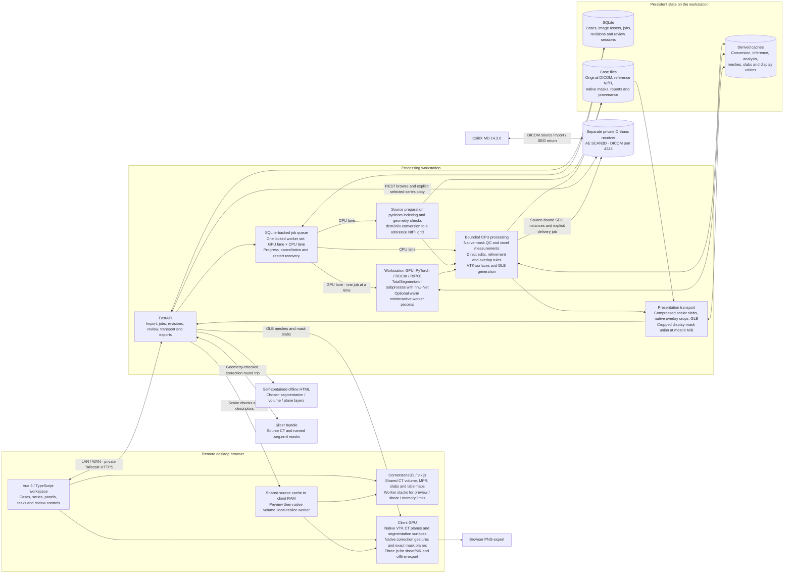
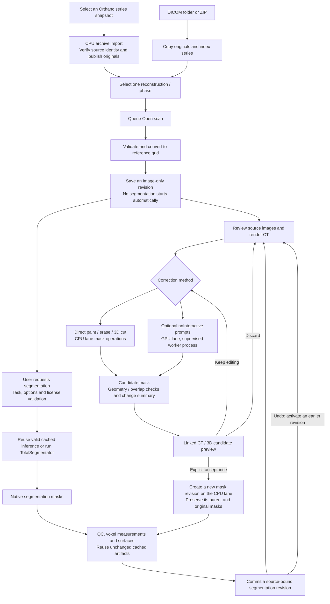
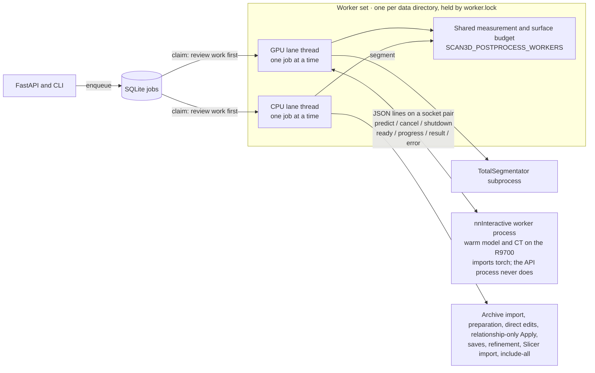

# 3DScan architecture

3DScan is an AI-assisted analysis workbench for radiologists that complements
viewers such as OsiriX. A high-quality, responsive viewer supports testing,
comparing, correcting and using segmentation and other analysis tools.

This describes the implementation as of **28 October 2026**. At the user's
request, the live service now uses the development checkout, activated from
`09ff189`, with `SCAN3D_MODALITIES=CT` keeping MRI turned off. The previous
`ct-hardening-20261027` snapshot remains available for rollback. Static 3D MRI
is implemented and tested on `expansion`; X-ray, mammography, ultrasound, catheter
angiography and cine ingestion still need their own adapters. Modality enum
values alone do not enable those workflows.

The incoming Orthanc adapter and OsiriX receiver are active for selected-series
import. The broader clinic archive
direction is recorded in [CLINIC_INTEGRATION.md](./CLINIC_INTEGRATION.md).
See [Orthanc operation](ORTHANC.md) for activation and connection settings.

The editable Mermaid flows are below. The standalone overview is available
as [SVG](./diagrams/architecture.svg); its layout source is
[render_architecture.py](./diagrams/render_architecture.py).

## System boundaries

The workstation parses DICOM; Cornerstone receives prepared reference-grid
voxels, never raw DICOM. After full preload, one Cornerstone ImageVolume and
RenderingEngine serve three orthographic viewports. Native i-fastest slices
arrive through bounded slabs from the existing worker. Identity-scaled integer
samples remain integer; other source scalars are scaled once to float32. Slice
origins and all affine direction signs are preserved, including reflected grids.

Crosshairs support translation and oblique rotation. MIP/MinIP affect only the
source CT actor; independent binary labelmaps show the centre plane. Native
review resets orientation to exact source-index planes and disables rotation
and slabs while drawing. Camera projections supply patient RAS gesture positions;
only a proven integer native plane can authorize axis/index/u/v drawings.

Preview, sheared and over-budget sources retain Cornerstone worker-resliced
stacks and exact scalar/binary `/review-frame` transport. A sheared native frame
gets an orthogonal display raster within the same patient plane, with its original
footprint and native index retained for inverse-affine gesture mapping. No
resampled display grid becomes a source mask or measurement grid.

A shared reservation budget charges the worker source once per immutable identity
and each visible renderer's CPU/GPU copies separately. The default is 2 GiB on
desktop and 256 MiB on explicitly low-memory devices; float32 source-copy and GPU
estimates are conservative. Mask staging includes current and replacement copies.
Hidden 2D/3D views abort uploads and release their owned GPU resources and
reservations, retaining the App-owned worker for reuse. These are allocation
estimates, not measurements of driver VRAM. A volume that cannot fit uses the
existing Cornerstone stack path with an explanation and Retry.

Source download, renderer and overlay errors have distinct Retry paths. A shared
context failure releases the engine, labelmaps, tools and image cache before
rebuilding from the resident CT. Candidate changes replace mask display copies
while retaining the source volume and camera. Warm navigation,
windowing and camera changes use resident client data. The client browser GPU
handles viewing; the workstation ROCm GPU handles model inference.

Following the synthetic [3D renderer comparison](VOLUME_RENDERING_COMPARISON.md),
the live orthogonal CT view defaults to **Cornerstone3D**, using vtk.js ray
casting, native lighting/scattering, crop planes and PNG capture. A session-owned
source lease shares one ImageVolume, texture, context and memory reservation
between visible 3D and MPR consumers. Either panel can open first or close
independently; there are no hidden MPR canvases. The final consumer releases the
engine, images and texture. The App-owned worker remains available for reuse.

Native VTK actors load only enabled revision surfaces from quantized GLBs and display an optional exact native CT
plane. The plane gathers only one bounded 2D raster from Cornerstone's voxel
manager, without assembling another full CT buffer. Plane CPU/GPU bytes and
retained/staged surface geometry join the shared memory budget. A hidden native
plane retains its bounded raster/texture cache and reservation until the 3D
feature is disposed. With CT visible,
surfaces are opaque for correct depth composition; surface-only views support
transparency. Pending or failed mesh replacements hide the previous revision's
actors until an atomic replacement succeeds. Plane/surface errors leave CT
rendering available. Source masks remain authoritative.

Native **Mask to segmentation** uses the existing revision-bound display union,
capped at 8 MiB, in one nearest-sampled R8 crop texture. Full-affine transforms
map CT ray positions into that crop; samples outside it are rejected for inside
mode and retained for outside mode. Masking gates primary opacity, native
scattering and ambient occlusion, without modifying CT normals, source samples,
slice overlays or measurement masks. The provider's decoded cache is released
after upload; only the crop texture remains. Empty/loading/error states hide CT
in either mode, and Retry rebuilds just the mask. Mode/camera/crop changes reuse
the texture; source/revision changes invalidate it before replacement.

Native **Color segments** uses a revision-bound label union from the same
cropping pipeline: each crop voxel stores the index of the chosen structure
covering it, painted largest first. A second nearest-sampled R8 crop texture
(at most 8 MiB) feeds a guarded shader hook that tints the transfer-function
colour before lighting, so shading, scattering and shadows stay the CT's own
and opacity is untouched. Colours and strength are uniforms; only a new
selection reloads labels. A second hook slot on the same mapper node lets it
compose with masking.

Native CT lighting exposes the same vtk.js scattering and local ambient
occlusion used by VolView, without embedding another application or creating
another volume. A separate panel-owned lighting state selects preset, standard,
cinematic/hybrid or ambient occlusion and adjusts material coefficients. Manual
modes own one scene light on the 3D renderer; camera events update a following
light, while a fixed light retains its patient-RAS pose. The shared engine’s MPR
renderers retain their own lights and properties. Retry retains the fixed pose
for the same source, and disposal restores renderer lights and deletes only the
owned light. Preset mode preserves earlier appearance and heart-scattering
behavior. No portable recipe/API schema or dependency version changes. See
[VolView rendering](VOLVIEW_RENDERING.md).

The isolated mask bridge installs an actor-local view-node factory before VTK
freezes its public API. It extends the pinned Core streaming mapper, sharing the
original CT texture, and uses guarded shader replacements. Other actors/MPR
retain their original factories. One relative import to Core's unexported
streaming-mapper extension is version guarded; dependency updates require mask
shader/browser qualification. The ray caster itself remains maintained upstream.

CT transfer slabs are reserved only during image-cache preparation. Surface
admission charges all retained CPU arrays and expanded GPU triangles plus one
largest-part upload scratch allowance; unused hardware-selection maps are
disabled. Retained and staged revisions remain charged together until commit.
The 2 GiB desktop / 256 MiB low-memory caps are unchanged.

Full orthogonal CT corrections remain in the same native 3D viewport. CPU cell
picking is restricted to the visible locked target actor and uses the actual
Cornerstone camera/viewport transform. Plane drawings consume the existing exact
native HU/binary-mask frames, painted into one bounded RGBA plane with full-affine
LPS geometry. Candidate and parent comparison retain their immutable mask context.
Frame cache/transport, retained and staged plane pixels join the shared budget;
there is no second full CT or full-grid mask allocation.

Point, brush, box, scribble/lasso and full-depth scissors use the existing prompt
contracts. Cornerstone's tool group handles right-drag rotation, middle-drag pan
and wheel zoom while marking owns the left button. Camera, viewport, native slice,
source, target, tool and disabled changes cancel active gestures. New planes and
surfaces authorize input only after rendering; pending/failed replacements never
authorize old geometry. SVG prompt markers follow the physical projection and
join PNG capture. Apply/Save, authoritative mask operations and exact revision
history remain on the workstation.

Three.js loads on demand for legacy mode, sheared grids, MRI and portable HTML.
HTML export requires the legacy renderer; the offline entry contains no
Cornerstone runtime. Review entry hides CT and shows segmentation, restoring the
earlier layer choices on exit without replacing the native source or camera.
Camera state remains patient RAS, including parallel scale and finite ordered
clipping ranges that may cross zero. VTK scattering differs from Three's reference
shader; the migration does not establish Slicer rendering equivalence.

Native reference images and masks remain authoritative for editing and
measurements. GLB meshes and the bounded 3D mask union are derived presentation
artifacts. Their simplification never changes mask-derived volumes.

GLB packaging also prepares deterministic streaming gzip siblings. The API
negotiates the compressed or original representation without recompressing each
response; old assets fill this cache on their first gzip request. Atomic writes,
per-file locks and source/output stat identities reject incomplete or stale
cache entries. Compression IO failures permit raw downloads. Byte ranges keep
raw offsets, and ETags identify the selected representation. This transport
cache changes neither mesh identity nor mask-derived measurements.

## Incoming Orthanc boundary

Source preparation uses pydicom for DICOM metadata, dcm2niix for conversion and
nibabel for full-affine NIfTI handling. SimpleITK 2.5.2 is already pinned for
downstream imaging dependencies; the app does not directly import it. Consider
it for specific future registration/filter operations with explicit RAS/LPS and
array-order adapters. Its NIfTI IO can reject or orthogonalize sheared grids,
and spacing-aware filters do not necessarily honor the full affine, so it does
not replace the authoritative readers or geometry-aware measurements. Installed
TotalSegmentator 2.18.0 converts direct DICOM input using dicom2nifti, while this
app supplies the already-prepared NIfTI and avoids that second conversion.

Orthanc owns its archive/index independently of 3DScan's case records. The
backend keeps archive credentials, performs REST searches and returns bounded
study/series summaries. Browser searches send identity fields in POST bodies;
all connector responses use `no-store`. The client never receives archive
credentials or parses the original DICOM.

The same Orthanc now serves a separate OHIF 3.12.0 browser application through
its OHIF 1.8 and DICOMweb 1.24 plugins. The explicit DICOMweb data source uses
relative `/dicom-web/` URLs; authenticated private HTTPS on port `8444` provides
the secure browser context for MPR. OHIF uses the archive's own login and reads
DICOM directly, independently of 3DScan's prepared-volume viewer. Opening an
OHIF study does not create a 3DScan case, revision or inference job. Existing
archive ownership, import provenance and saved-mask export contracts remain.
See [OHIF operation](ORTHANC.md#ohif-browser-viewer-with-dicomweb).

Orthanc Explorer 2 **1.15.0** is active after the approved Orthanc-only restart
on 29 October 2026. Its optional archive UI at `/ui/app/` uses the existing
Orthanc login and private HTTPS port `8444`, including links to the existing
OHIF viewer. The legacy default UI, current authentication and archive/application
boundaries remain unchanged. See [trial operation](ORTHANC.md#explorer-2-trial).

The existing OsiriX Mac also has explicitly approved DICOM C-FIND/C-MOVE
permissions on Orthanc, separate from 3DScan's REST adapter and outgoing sends.
Strict calling/called AE and source-IP checks remain enforced. This enables
direct OsiriX Query/Retrieve without routing searches through 3DScan.

The existing `osirix` peer now uses the Mac's Tailscale address
`100.64.0.20:11112`; OsiriX should target workstation
`100.64.0.10:4243`, called AE `SCAN3D`. Only the peer host was persisted and
hot-applied, without service restarts or firewall edits. Incoming C-ECHO awaits
the user's retry. Reverse TCP connectivity works but the DICOM association
aborts, so bidirectional Tailscale transport is not yet qualified. See
[switch status](ORTHANC.md#tailscale-dicom-switch).

Explicit import queues a CPU job for one immutable series snapshot. Known
incomplete/receiving series are blocked; unknown declared counts retain a visible
warning. Bounded downloads check snapshot membership before/after transfer, then
independently verify content hashes and DICOM identities before indexing and
publication. Repeated snapshots deduplicate to one job/case. Failed/cancelled
attempts remain retryable, and startup reconciles interrupted imports without
starting a transfer automatically. Source bytes moved before a failed commit
remain unreferenced and are never overwritten by a retry.

Private source manifests retain original instance references and hashes. Public
source digests accompany the prepared immutable image asset. Import does not
convert or segment; a separate **Open CT** action prepares the reference image
on the CPU lane. The receiver's Mac/IP/AE allowlist, administrator-applied UFW
rule and main-app restart approval remain prerequisites for activation. The
separate synthetic development archive remains available.

Saved-revision SEG export runs on the CPU lane. The adapter binds the original
Orthanc source manifest/archive, immutable reference image, selected masks and
enqueue-time file identities before encoding. Full RAS/LPS affine checks prove
that every original CT pixel matches an integer native voxel; no mask resampling
is allowed. Every slice's four corners must agree within both 0.05 voxel per
axis and 0.05 mm in patient space. These bounds accommodate accumulated
converter/metadata rounding while retaining unambiguous integer addressing,
exact dimensions and complete source coverage. All selected nonempty structures
become independently numbered segments in one binary SEG instance. Each native
mask and its source-plane projection are processed separately; packed bits stream
through a temporary file into Pixel Data, avoiding a structures-by-volume array.
Frame dimension indices are rebuilt consistently across all segments, including
disjoint occupied slices and overlapping masks. Only CT headers are read;
source CT pixel arrays are not assembled.
UTF-8 metadata preserves source names and segment labels, and corrected masks
are described as semiautomatic 3DScan outputs rather than untouched model output.
Segment identification is stored per frame, matching the accepted synthetic
OsiriX prototype; the same functional group is removed from shared metadata.

An immutable export manifest pins SEG/mask/reference hashes and SOP identities
before upload. Orthanc retains and sends the same files, with read-back hashing
protecting against a different object already stored under the same UID. Server
allowlisted modality IDs control outgoing destinations. Delivery intent/job IDs
are persisted separately; an explicit retry checks any known Orthanc job and
reuses exact SOP bytes. Startup never sends or resumes an export automatically.
Polling stops after 120 seconds with an unconfirmed outcome if the remote job
has not finished. Explicit **Send again** starts a new delivery attempt only
after known success, while ordinary duplicate requests reuse the prior job.
Encoding versions namespace artifacts separately from frozen input identities.
A new encoder profile requires an explicit fresh export with new SOPs; older
artifacts and delivery receipts stay intact, and version changes cannot bypass
mask mutation checks. The UI offers resend only for the current encoding.
Export never changes or activates a segmentation revision. The first adapter
requires an original classic CT imported through the configured archive.

Synthetic API-to-Orthanc-to-OsiriX transport and prototype basic ROI display
pass. The per-frame update enabled discovery, but the user reports only one
of eight masks showing from separate SEG objects. The combined-instance update
matches the prototype's multi-segment packaging, and the user confirms all eight
segments now display in OsiriX MD 14.3.0. On 29 October 2026 the user explicitly
confirms they have verified that SEG works in OsiriX; the active combined SEG
return workflow is user-verified. highdicom 0.28.2 and pyjpegls 1.5.1 are pinned
in the deployment lock. The integrated feature
is qualified and active; [the runbook](ORTHANC.md) records runtime details.

`osirix_roi.py` and `osirix_roi_archive.py` provide an experimental, standalone
native OsiriX MD 14.3 brush writer. They reuse the SEG source-grid proof, gather
exact independent mask planes and spool packed bits with one dense mask at a
time. Each occupied source image receives a Basic Text SR containing every
selected nonempty brush on that image. Named-key binary plists use documented
Apple LZ4 stored-block framing, with no new dependency or Mac runtime required.
Fresh report/series/brush identities and exact source SOP/evidence references
avoid using returned patient archives as templates. The package is published
with Linux exclusive atomic rename after input stamp/hash checks; cancellation
and failure discard owned staging. No route, job integration, dependency change
or live runtime activation accompanies this writer. The user confirms the first
synthetic native import/display works. Editing/save/reload, app integration and
broader source-geometry qualification remain before production activation.

## Scan and correction lifecycle

## Job lanes and the nnInteractive worker

Queued processing runs on two background threads backed by SQLite and one
filesystem process lock, not an external broker. The GPU lane runs
TotalSegmentator and nnInteractive predictions strictly one at a time. The CPU
lane runs everything that never touches the GPU, so direct edits and saves no
longer wait behind a segmentation. Each lane takes review work before queued
batch work. Transactional active-revision and generation guards, not queue
order, decide between jobs that finish on different lanes.

nnInteractive runs in a supervised child process that the GPU lane starts on
demand, keeping its model warm between Apply batches. A crash, hang or GPU
failure fails only that job; the next request starts a fresh child. Ignored
cancellation is enforced by killing the child's process group after a grace
period. Before TotalSegmentator runs, the child exits to return all of its VRAM.

Dense mask analysis and surface preparation use bounded CPU thread pools that
share one service-wide budget across both lanes. Completed stages remain
reusable after cancellation or restart.

## Code map

- [HTTP middleware and error mapping](../scan3d/api.py) with [request bodies](../scan3d/api_models.py) and routes for [health, catalogs and the license](../scan3d/api_system.py), [imports](../scan3d/api_imports.py), [case, job and revision records](../scan3d/api_cases.py), [correction sessions](../scan3d/api_reviews.py) and [viewer volumes, frames and exports](../scan3d/api_viewer.py).
- [Job lanes, dispatch and revision building](../scan3d/service.py), [SQLite, claims and activation](../scan3d/store.py).
- [nnInteractive engine](../scan3d/interactive.py) and its [supervised worker process](../scan3d/interactive_worker.py).
- [DICOM preparation](../scan3d/dicom.py), [inference](../scan3d/segmentation.py), [native operations and measurements](../scan3d/imaging.py).
- [Read-only Orthanc REST transport](../scan3d/orthanc.py), [validated immutable archive records](../scan3d/orthanc_models.py), [snapshot import and recovery](../scan3d/orthanc_imports.py), [source-bound DICOM SEG encoding](../scan3d/dicom_seg.py) and [delivery](../scan3d/orthanc_exports.py), [receiver operation](ORTHANC.md).
- [CPU contouring and surface caches](../scan3d/surfaces.py), [GLB encoding and decoding](../scan3d/surface_glb.py), [reusable gzip transport files](../scan3d/compressed_files.py), [bounded hashing, archive extraction and atomic artifact publication](../scan3d/fileio.py).
- [Candidate review and acceptance](../scan3d/review.py), [scalar/mask transport](../scan3d/review_volume.py), [display and label unions](../scan3d/volume_mask_union.py), [segment colour labels](../web/src/lib/vtk-volume-labels.ts).
- [Browser source worker](../web/src/lib/ct-volume.ts), [Cornerstone stack adapter](../web/src/lib/cornerstone-runtime.ts), [native MPR](../web/src/lib/cornerstone-mpr.ts), [shared memory budget](../web/src/lib/volume-memory-budget.ts), [3D scene](../web/src/lib/scene.ts), [volume renderer](../web/src/lib/ct-volume-renderer.ts).
- [Portable export](../scan3d/portable_export.py), [embedded offline data](../web/src/lib/portable-viewer.ts), [MRI expansion boundaries](./EXPANSION_FOUNDATION.md).
- The [workspace shell](../web/src/App.vue) delegates [local source streaming](../web/src/lib/use-local-ct.ts), the [crosshair value probe](../web/src/lib/use-image-probe.ts), the [candidate 3D preview](../web/src/lib/use-candidate-surface.ts) and [per-image colour preferences](../web/src/lib/use-structure-colors.ts).
- [3D viewport orchestration](../web/src/components/ModelViewport.vue) delegates [expansion and focus](../web/src/lib/use-expanded-viewport.ts) and [reference measurement](../web/src/lib/use-cinematic-reference.ts); both app shells share [structure display actions](../web/src/lib/use-structure-display.ts).
- The workspace grid places a resizable sidebar beside a stage of tiled viewers. [Layout preferences](../web/src/lib/workspace-panels.ts) validate panel visibility, arrangement and tile sizes; the [splitter](../web/src/components/WorkspaceSplitter.vue) resizes tracks only, so viewers never remount. Viewer options [fold away](../web/src/lib/use-folding-controls.ts) or [float as menus](../web/src/lib/use-floating-details.ts) instead of taking viewer height.
- [Browser protocol helper](../web/tests/browser_driver.py) supplies HTTP, WebDriver sessions and polling to standalone synthetic regressions. Runners retain their fixture guards, assertions, renderer options and process cleanup.
