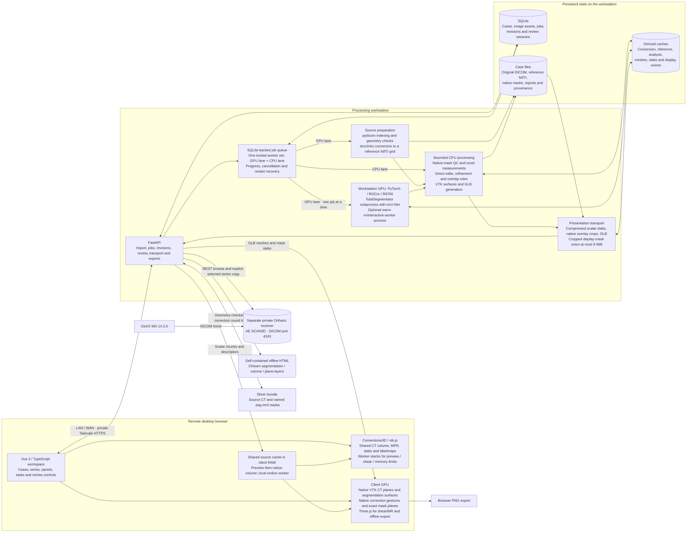
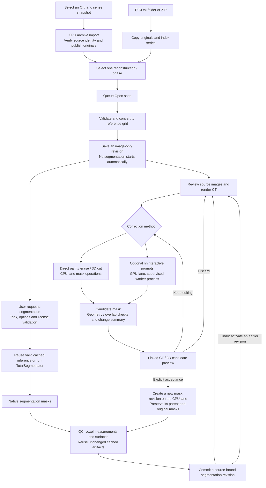

# 3DScan architecture

3DScan is an AI-assisted analysis workbench for radiologists that complements
viewers such as OsiriX. A high-quality, responsive viewer supports testing,
comparing, correcting and using segmentation and other analysis tools.

This describes the implementation as of **28 October 2026**. At the user's
request, the live service now uses the development checkout, activated from
`09ff189`, with `SCAN3D_MODALITIES=CT` keeping MRI turned off. The previous
`ct-hardening-20261027` snapshot remains available for rollback. Static 3D MRI
is implemented and tested on `expansion`; X-ray, mammography, ultrasound, catheter
angiography and cine ingestion still need their own adapters. Modality enum
values alone do not enable those workflows.

The incoming Orthanc adapter and OsiriX receiver are active for selected-series
import. The broader clinic archive
direction is recorded in [CLINIC_INTEGRATION.md](./CLINIC_INTEGRATION.md).
See [Orthanc operation](ORTHANC.md) for activation and connection settings.

The editable Mermaid flows are below. The standalone overview is available
as [SVG](./diagrams/architecture.svg); its layout source is
[render_architecture.py](./diagrams/render_architecture.py).

## System boundaries

The workstation parses DICOM; Cornerstone receives prepared reference-grid
voxels, never raw DICOM. After full preload, one Cornerstone ImageVolume and
RenderingEngine serve three orthographic viewports. Native i-fastest slices
arrive through bounded slabs from the existing worker. Identity-scaled integer
samples remain integer; other source scalars are scaled once to float32. Slice
origins and all affine direction signs are preserved, including reflected grids.

Crosshairs support translation and oblique rotation. MIP/MinIP affect only the
source CT actor; independent binary labelmaps show the centre plane. Native
review resets orientation to exact source-index planes and disables rotation
and slabs while drawing. Camera projections supply patient RAS gesture positions;
only a proven integer native plane can authorize axis/index/u/v drawings.

Preview, sheared and over-budget sources retain Cornerstone worker-resliced
stacks and exact scalar/binary `/review-frame` transport. A sheared native frame
gets an orthogonal display raster within the same patient plane, with its original
footprint and native index retained for inverse-affine gesture mapping. No
resampled display grid becomes a source mask or measurement grid.

A shared reservation budget charges the worker source once per immutable identity
and each visible renderer's CPU/GPU copies separately. The default is 2 GiB on
desktop and 256 MiB on explicitly low-memory devices; float32 source-copy and GPU
estimates are conservative. Mask staging includes current and replacement copies.
Hidden 2D/3D views abort uploads and release their owned GPU resources and
reservations, retaining the App-owned worker for reuse. These are allocation
estimates, not measurements of driver VRAM. A volume that cannot fit uses the
existing Cornerstone stack path with an explanation and Retry.

Source download, renderer and overlay errors have distinct Retry paths. A shared
context failure releases the engine, labelmaps, tools and image cache before
rebuilding from the resident CT. Candidate changes replace mask display copies
while retaining the source volume and camera. Warm navigation,
windowing and camera changes use resident client data. The client browser GPU
handles viewing; the workstation ROCm GPU handles model inference.

Following the synthetic [3D renderer comparison](VOLUME_RENDERING_COMPARISON.md),
the live orthogonal CT view defaults to **Cornerstone3D**, using vtk.js ray
casting, native lighting/scattering, crop planes and PNG capture. A session-owned
source lease shares one ImageVolume, texture, context and memory reservation
between visible 3D and MPR consumers. Either panel can open first or close
independently; there are no hidden MPR canvases. The final consumer releases the
engine, images and texture. The App-owned worker remains available for reuse.

Native VTK actors load only enabled revision surfaces from quantized GLBs and display an optional exact native CT
plane. The plane gathers only one bounded 2D raster from Cornerstone's voxel
manager, without assembling another full CT buffer. Plane CPU/GPU bytes and
retained/staged surface geometry join the shared memory budget. A hidden native
plane retains its bounded raster/texture cache and reservation until the 3D
feature is disposed. With CT visible,
surfaces are opaque for correct depth composition; surface-only views support
transparency. Pending or failed mesh replacements hide the previous revision's
actors until an atomic replacement succeeds. Plane/surface errors leave CT
rendering available. Source masks remain authoritative.

Native **Mask to segmentation** uses the existing revision-bound display union,
capped at 8 MiB, in one nearest-sampled R8 crop texture. Full-affine transforms
map CT ray positions into that crop; samples outside it are rejected for inside
mode and retained for outside mode. Masking gates primary opacity, native
scattering and ambient occlusion, without modifying CT normals, source samples,
slice overlays or measurement masks. The provider's decoded cache is released
after upload; only the crop texture remains. Empty/loading/error states hide CT
in either mode, and Retry rebuilds just the mask. Mode/camera/crop changes reuse
the texture; source/revision changes invalidate it before replacement.

The isolated mask bridge installs an actor-local view-node factory before VTK
freezes its public API. It extends the pinned Core streaming mapper, sharing the
original CT texture, and uses guarded shader replacements. Other actors/MPR
retain their original factories. One relative import to Core's unexported
streaming-mapper extension is version guarded; dependency updates require mask
shader/browser qualification. The ray caster itself remains maintained upstream.

CT transfer slabs are reserved only during image-cache preparation. Surface
admission charges all retained CPU arrays and expanded GPU triangles plus one
largest-part upload scratch allowance; unused hardware-selection maps are
disabled. Retained and staged revisions remain charged together until commit.
The 2 GiB desktop / 256 MiB low-memory caps are unchanged.

Full orthogonal CT corrections remain in the same native 3D viewport. CPU cell
picking is restricted to the visible locked target actor and uses the actual
Cornerstone camera/viewport transform. Plane drawings consume the existing exact
native HU/binary-mask frames, painted into one bounded RGBA plane with full-affine
LPS geometry. Candidate and parent comparison retain their immutable mask context.
Frame cache/transport, retained and staged plane pixels join the shared budget;
there is no second full CT or full-grid mask allocation.

Point, brush, box, scribble/lasso and full-depth scissors use the existing prompt
contracts. Cornerstone's tool group handles right-drag rotation, middle-drag pan
and wheel zoom while marking owns the left button. Camera, viewport, native slice,
source, target, tool and disabled changes cancel active gestures. New planes and
surfaces authorize input only after rendering; pending/failed replacements never
authorize old geometry. SVG prompt markers follow the physical projection and
join PNG capture. Apply/Save, authoritative mask operations and exact revision
history remain on the workstation.

Three.js loads on demand for legacy mode, sheared grids, MRI and portable HTML.
HTML export requires the legacy renderer; the offline entry contains no
Cornerstone runtime. Review entry hides CT and shows segmentation, restoring the
earlier layer choices on exit without replacing the native source or camera.
Camera state remains patient RAS, including parallel scale and finite ordered
clipping ranges that may cross zero. VTK scattering differs from Three's reference
shader; the migration does not establish Slicer rendering equivalence.

Native reference images and masks remain authoritative for editing and
measurements. GLB meshes and the bounded 3D mask union are derived presentation
artifacts. Their simplification never changes mask-derived volumes.

## Incoming Orthanc boundary

Orthanc owns its archive/index independently of 3DScan's case records. The
backend keeps archive credentials, performs REST searches and returns bounded
study/series summaries. Browser searches send identity fields in POST bodies;
all connector responses use `no-store`. The client never receives archive
credentials or parses the original DICOM.

Explicit import queues a CPU job for one immutable series snapshot. Known
incomplete/receiving series are blocked; unknown declared counts retain a visible
warning. Bounded downloads check snapshot membership before/after transfer, then
independently verify content hashes and DICOM identities before indexing and
publication. Repeated snapshots deduplicate to one job/case. Failed/cancelled
attempts remain retryable, and startup reconciles interrupted imports without
starting a transfer automatically. Source bytes moved before a failed commit
remain unreferenced and are never overwritten by a retry.

Private source manifests retain original instance references and hashes. Public
source digests accompany the prepared immutable image asset. Import does not
convert or segment; a separate **Open CT** action prepares the reference image
on the CPU lane. The receiver's Mac/IP/AE allowlist, administrator-applied UFW
rule and main-app restart approval remain prerequisites for activation. The
separate synthetic development archive is already available. Segmentation
return to OsiriX is deferred; [the runbook](ORTHANC.md) records current status.

## Scan and correction lifecycle

## Job lanes and the nnInteractive worker

```mermaid
flowchart LR
  CLIENTS["FastAPI and CLI"] -->|"enqueue"| JOBS[("SQLite jobs")]
  subgraph WORKERS["Worker set · one per data directory, held by worker.lock"]
    direction TB
    GPULANE["GPU lane thread<br/>one job at a time"]
    CPULANE["CPU lane thread<br/>one job at a time"]
    BUDGET["Shared measurement and surface budget<br/>SCAN3D_POSTPROCESS_WORKERS"]
    GPULANE --> BUDGET
    CPULANE --> BUDGET
  end
  JOBS -->|"claim: review work first"| GPULANE
  JOBS -->|"claim: review work first"| CPULANE
  GPULANE -->|"segment"| TS["TotalSegmentator subprocess"]
  GPULANE <-->|"JSON lines on a socket pair<br/>predict / cancel / shutdown<br/>ready / progress / result / error"| CHILD["nnInteractive worker process<br/>warm model and CT on the R9700<br/>imports torch; the API process never does"]
  CPULANE --> CPUWORK["Archive import, preparation, direct edits, relationship-only Apply,<br/>saves, refinement, Slicer import, include-all"]
```

Queued processing runs on two background threads backed by SQLite and one
filesystem process lock, not an external broker. The GPU lane runs
TotalSegmentator and nnInteractive predictions strictly one at a time. The CPU
lane runs everything that never touches the GPU, so direct edits and saves no
longer wait behind a segmentation. Each lane takes review work before queued
batch work. Transactional active-revision and generation guards, not queue
order, decide between jobs that finish on different lanes.

nnInteractive runs in a supervised child process that the GPU lane starts on
demand, keeping its model warm between Apply batches. A crash, hang or GPU
failure fails only that job; the next request starts a fresh child. Ignored
cancellation is enforced by killing the child's process group after a grace
period. Before TotalSegmentator runs, the child exits to return all of its VRAM.

Dense mask analysis and surface preparation use bounded CPU thread pools that
share one service-wide budget across both lanes. Completed stages remain
reusable after cancellation or restart.

## Code map

- [API and transport](../scan3d/api.py), [job lanes, dispatch and revision building](../scan3d/service.py), [SQLite, claims and activation](../scan3d/store.py).
- [Orthanc transport](../scan3d/orthanc.py), [validated immutable archive records](../scan3d/orthanc_models.py), [CPU import and recovery](../scan3d/orthanc_imports.py).
- [nnInteractive engine](../scan3d/interactive.py) and its [supervised worker process](../scan3d/interactive_worker.py).
- [DICOM preparation](../scan3d/dicom.py), [inference](../scan3d/segmentation.py), [native operations and measurements](../scan3d/imaging.py).
- [Read-only Orthanc REST transport](../scan3d/orthanc.py), [snapshot import and recovery](../scan3d/orthanc_imports.py), [receiver operation](ORTHANC.md).
- [CPU contouring and surface caches](../scan3d/surfaces.py), [GLB encoding and decoding](../scan3d/surface_glb.py), [bounded hashing and atomic artifact publication](../scan3d/fileio.py).
- [Candidate review and acceptance](../scan3d/review.py), [scalar/mask transport](../scan3d/review_volume.py), [display union](../scan3d/volume_mask_union.py).
- [Browser source worker](../web/src/lib/ct-volume.ts), [Cornerstone stack adapter](../web/src/lib/cornerstone-runtime.ts), [native MPR](../web/src/lib/cornerstone-mpr.ts), [shared memory budget](../web/src/lib/volume-memory-budget.ts), [3D scene](../web/src/lib/scene.ts), [volume renderer](../web/src/lib/ct-volume-renderer.ts).
- [Portable export](../scan3d/portable_export.py), [embedded offline data](../web/src/lib/portable-viewer.ts), [MRI expansion boundaries](./EXPANSION_FOUNDATION.md).
- [3D viewport orchestration](../web/src/components/ModelViewport.vue) delegates [expansion and focus](../web/src/lib/use-expanded-viewport.ts) and [reference measurement](../web/src/lib/use-cinematic-reference.ts); both app shells share [structure display actions](../web/src/lib/use-structure-display.ts).
- [Browser protocol helper](../web/tests/browser_driver.py) supplies HTTP, WebDriver sessions and polling to standalone synthetic regressions. Runners retain their fixture guards, assertions, renderer options and process cleanup.
