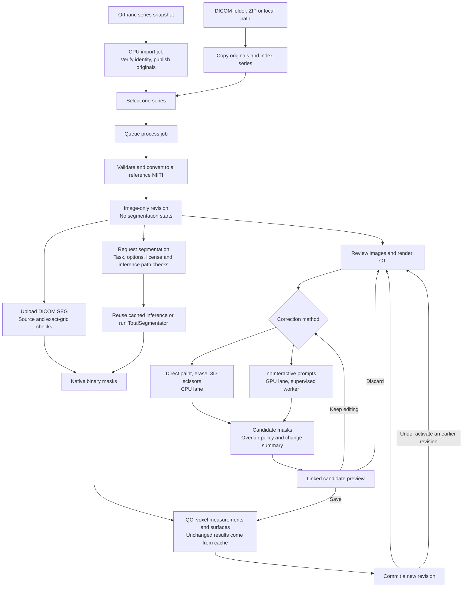

# Architecture

3DScan is a local workbench for reviewing AI segmentation of CT scans. It imports DICOM, runs
TotalSegmentator on request, lets a reader correct masks by hand or with nnInteractive, keeps an
exact history of saved changes, and shows the result in a browser viewer. It is for research use
and complements a diagnostic viewer rather than replacing one.

[API.md](API.md) is the HTTP contract and data model. To run the software, see
[INSTALL.md](INSTALL.md), [CONFIGURATION.md](CONFIGURATION.md), [USER_GUIDE.md](USER_GUIDE.md),
[ORTHANC.md](ORTHANC.md) and [DEVELOPMENT.md](DEVELOPMENT.md).


`docs/diagrams/render_architecture.py` generates the diagram.

## Design rules

- **Masks are authoritative.** Binary masks on the source voxel grid are the only input to
  measurements, edits and exports.
- **Saved work is immutable.** Every change creates a new revision. Undo activates an earlier one.
- **Geometry is physical.** Positions are patient RAS millimetres with the full affine.
- **The browser renders, the server computes.** The server parses DICOM, runs inference and edits
  masks.
- **Expensive work is explicit.** Opening a scan does not segment it, and viewing never starts
  inference.

## Components

| Where    | Component            | Role                                                                     |
| -------- | -------------------- | ------------------------------------------------------------------------ |
| Server   | API process          | `scan3d serve`: FastAPI, two lane threads, CPU pools, built viewer files |
| Server   | TotalSegmentator     | A subprocess per task, started by the GPU lane in the job's interpreter  |
| Server   | nnU-Net worker       | The same kind of subprocess for a pinned nnU-Net model                   |
| Server   | nnInteractive worker | A long-lived supervised child with the warm model for one inference path |
| Browser  | Main thread          | Vue 3 workspace, Cornerstone3D, vtk.js and Three.js rendering            |
| Browser  | CT worker            | Web Worker that decodes slabs, holds the source and reslices frames      |
| Optional | Orthanc              | A separate DICOM server, reached only over its REST API                  |

### Code map

| Path                                                                    | Contents                                               |
| ----------------------------------------------------------------------- | ------------------------------------------------------ |
| `scan3d/api.py`, `api_*.py`, `api_models.py`                            | HTTP app, error mapping, routes, request bodies        |
| `scan3d/access.py`, `accounts.py`, `identity.py`                        | Route rules, accounts, sessions, audit, password hash  |
| `scan3d/service.py`, `store.py`, `config.py`, `__main__.py`             | Lanes, revision building, SQLite, settings, the CLI    |
| `scan3d/dicom.py`, `enhanced_mr.py`, `modalities.py`, `image_assets.py` | Series validation, conversion, image identity          |
| `scan3d/segmentation*.py`                                               | TotalSegmentator runs, task catalog, result merging    |
| `scan3d/nnunet_models.py`, `nnunet_worker.py`                           | Pinned nnU-Net models and their worker                 |
| `scan3d/review.py`, `relationships.py`, `direct_edit.py`, `scissors.py` | Correction sessions and deterministic edits            |
| `scan3d/interactive*.py`                                                | nnInteractive engine, worker, batching, prompts        |
| `scan3d/inference_paths.py`                                             | Inference paths: discovery, binding, child environment |
| `scan3d/imaging.py`, `surfaces.py`, `surface_glb.py`                    | Masks, measurements, slice geometry, GLB surfaces      |
| `scan3d/review_volume.py`, `volume_mask_union.py`                       | Volume and frame transport, display unions             |
| `scan3d/agreement.py`, `portable_export.py`, `slicer_io.py`             | Agreement metrics, offline HTML, Slicer exchange       |
| `scan3d/disk_usage.py`                                                  | Case sizes and the storage report                      |
| `scan3d/orthanc*.py`, `dicom_*.py`, `osirix_roi*.py`                    | Orthanc connector, DICOM SEG and view, OsiriX ROIs     |
| `web/src/App.vue`, `web/src/components/`, `web/src/lib/use-*.ts`        | Workspace shell, panels and composables                |
| `web/src/components/AuthGate.vue`, `web/src/lib/session.ts`             | Sign-in form, overlay and session state                |
| `web/src/components/CaseLibrary.vue`, `web/src/lib/library.ts`          | The Library: search, rename, Trash and storage         |
| `web/src/lib/ct-volume.ts`, `ct-worker.ts`                              | Source session and worker                              |
| `web/src/lib/cornerstone-*.ts`, `vtk-*.ts`                              | Slice review, MPR and the native 3D view               |
| `web/src/lib/scene.ts`, `ct-volume-renderer.ts`, `gpu-ct-plane.ts`      | The Three.js renderer                                  |
| `web/src/lib/volume-memory-budget.ts`, `portable-viewer.ts`             | Client memory ledger, offline viewer                   |

## Data flow



- **Import** copies originals into the case, and pydicom indexes every series. Unsupported series
  stay visible with the reason.
- **Prepare** is a `process` job. It runs dcm2niix on exactly one series, unless
  `converted/<sha256>/` already holds it, then checks the geometry and creates an image-only
  revision. Scan-region and timing labels never select frames, change intensities or choose a task.
- **Segment** is a `segment` job. It runs one TotalSegmentator task on the active revision at full
  resolution and keeps every nonempty output. Its cache key covers the image hash, options, package
  versions, wrapper code and device request.

## Store and revision model

All state lives under `SCAN3D_DATA_DIR`:

```text
scan3d.sqlite3           Records, in WAL mode
worker.lock              Held by the process that runs jobs
maintenance.lock         Shared by a backup and by demo, import and optimize; exclusive while files are deleted
cases/<case>/
  dicom/                 Originals from uploads and local imports
  sources/<job>/         Originals from Orthanc, with source-import.json
  converted/<sha256>/    Reference NIfTI and conversion log
  inference/<key>/       TotalSegmentator runs and their manifests
  revisions/<id>/        revision.json, model.glb and on-demand exports
  refinements/, corrections/, reviews/, seg-imports/, dicom-exports/
  dicom-view-captures/   Retained 3D view captures, each named by its SHA-256
  uploads/               Slicer corrections as received
  synthetic/             The demo phantom
surface-cache/, review-cache/, analysis-cache/, agreement-cache/, cinematic-cache/
import-uploads/          Staged browser uploads, removed after a day of inactivity
```

SQLite holds JSON records in `cases`, `image_assets`, `revisions`, `jobs` and `review_sessions`. A
record is committed only after its files are complete. Records store absolute paths, so restore a
`scan3d backup` into the same data directory.

`case_summaries` is a derived copy of each case without its file paths, so listing cases parses only
what the library shows. Any write to `cases` drops the copy, so a writer that skips it, such as an
older build after a rollback, makes the list read the full record and never a stale one. Each `Store`
keeps one idle connection open, because closing the last connection to a WAL database checkpoints it
and adds milliseconds to every write.

`users`, `sessions`, `one_time_codes`, `last_seen`, `case_access` and `audit_events` are ordinary
tables beside those records. `cases` has no owner column and there are no foreign keys. A backup
keeps users and audit and removes sessions and links, so a restore revives no sign-in.

`case_opened` holds when each account last opened each case, which orders that account's list. A
`trash` row hides its case and nothing on disk moves, so a restored case keeps its files and
revisions.

Delete forever moves a case's `trash` row from `trashed` to `purging`. Its first step,
`Store.purge_case`, deletes every row of the case in one transaction, so only that row and the audit
log keep its ID. While the row is `purging` or `purged`, triggers refuse any insert for its ID, in
this build or an older one, so a deleted case never comes back.

The janitor, a thread of the API server that holds `worker.lock`, does the rest under an exclusive
`maintenance.lock`. It removes the case's folder, the uploads that became it and the review-cache
entries naming it at once, then empties the write log. A file it cannot remove keeps only its own
case `purging`, and is tried again each minute.

The shared steps wait until no job runs, no request is in flight and no review volume is being
written, so while any job runs they and `purged` wait. They remove review entries naming no current
case, the caches rebuilt on a miss and every surface asset no record names. Then the janitor empties
the log again and sets `purged`, and the idle GPU lane releases the warm engine. A shared file it
cannot remove is logged and the other steps still run, but those cases stay `purging` and are tried
again each minute.

Every step can run again, so a purge resumes at the next start. Each start also removes Orthanc
staging leftovers, and once a run the janitor removes any folder of a purged case that came back.

Each review-cache entry's record names its case, outside its key, so Delete forever can find the
entry. A backup leaves out the folder of a deleted case, any surface asset its snapshot does not
name, and the contour and agreement caches, which rebuild on a miss.

- **Image assets** describe one source image and never change. Child revisions must keep the same
  source image.
- **Added series.** A series added from Orthanc keeps its own source record in `added_sources`, so
  an export binds to that series' files. It must come from the case's own study.
- **Revisions** form a tree through `parent_id`.
- **Structures** are a revision's segments, each with a stable ID and a private mask file. Masks are
  independent, so overlaps are preserved.
- **Activation.** A case has one active revision. `Store.commit_revision` publishes a revision,
  activates it and completes its job in one transaction, guarded by the expected active revision.
- **Replacing results.** A segmentation run replaces every structure from its task, plus structures
  of other tasks with an exactly matching anatomical name, so `total_v3:liver` replaces
  `total:liver`. Voxels are never subtracted. A conflicting result fails before anything is
  published.
- **Comparing models.** A pinned nnU-Net model's structures match only that model's, so
  `mrsegmentator:liver` and `total:liver` stay side by side. Its run has the source `nnunet_model`.

## Jobs and lanes

Jobs are SQLite rows. `Service.start` locks `worker.lock` and runs one thread per lane, so one
process per data directory executes jobs.

| Lane | Job kinds                                                                                                                                                                                                      |
| ---- | -------------------------------------------------------------------------------------------------------------------------------------------------------------------------------------------------------------- |
| GPU  | `segment`; `review_predict` that runs nnInteractive                                                                                                                                                            |
| CPU  | `process`, `orthanc_import`, `orthanc_export`, `orthanc_roi_export`, `orthanc_view_export`, `dicom_seg_import`, `refine`, `correction`, `include_all`, `review_accept`; `review_predict` for direct edits or relationship-only Apply |

- GPU jobs never overlap, whichever GPU they use, which keeps TotalSegmentator's shared settings and
  first-time weight downloads safe.
- CPU work never waits behind a segmentation.
- The GPU lane still runs when inference uses the CPU device.
- Review jobs run before queued batch work in each lane.
- A correction saved during a segmentation stays active. The segmentation fails at commit, and a
  retry from the current revision reuses its cached inference.

**Restart.** Running jobs fail as `Interrupted`, and draft sessions return to an editable state.
Queued jobs stay queued, except DICOM SEG and view exports, which fail locally because a send must
be requested explicitly.

**Cancellation** stops a queued job at once and a running job at its next check. Trash cancels a
case's jobs, and a job that starts afterwards stops at its first check.

**Requests in flight.** The gate counts each admitted request, in all and per case, until its
response is sent. Public routes and the API docs are not counted, and Restore and Delete forever
count in all only. A request that makes a case counts it from before its row exists, and a volume
build counts its case until its thread ends. The counts live in memory, so a restart resets them.

## Inference

`SCAN3D_DEVICE` selects the device on the default [inference path](#inference-paths), and
[INSTALL.md](INSTALL.md) lists its values. `auto` prefers a discrete GPU, then the most reported
memory, and uses the CPU if PyTorch sees no GPU. A GPU request never falls back, and a
TotalSegmentator report that shows CPU execution after one is rejected.

`scripts/check_gpu.py` writes a proof file, which `/api/health` reports without loading PyTorch.
`ready` means a verified GPU, so a CPU installation reports `ready: false` by design.

The API process never imports PyTorch. Before it runs the model, a `segment` job checks its device
in a short-lived child, `python -P -m scan3d.segmentation`, from the job's interpreter, and no
answer within 5 minutes fails the job. A server without AI packages still serves the viewer and
direct editing.

### The nnInteractive worker

The first prediction starts `python -P -m scan3d.interactive_worker` from the job's interpreter. It
keeps the model and image warm between Apply actions and exchanges newline-delimited JSON over an
inherited socket pair. It is a separate process so a GPU driver fault fails one job, not the server,
and because only process exit returns all GPU memory.

- **Cancellation** is cooperative first. After 10 seconds its process group is killed.
- **Failure.** A crash, a GPU or model failure, or 600 seconds without progress
  (`SCAN3D_NNINTERACTIVE_STALL_SECONDS`) fails that job only. The next prediction starts a fresh
  worker, which rebuilds the draft from its latest stored result.
- **Restore.** A request may name the stored result of its first Apply steps. Without warm state
  the worker loads that mask as upstream's initial mask and registers every applied mark again
  with no forward pass, which gives the warm session's state byte for byte. It checks the mask's
  hash and its own model, card and build first, and replays from the original mask otherwise. A
  trusted result it cannot rebuild from, such as another card's, is compared with the replay at its
  step, and moved voxels add a candidate warning. The field is optional, so the protocol stays 1:
  an older worker ignores it and replays.
- **Exit.** The worker exits before a `segment` job, at shutdown, if the API process dies, and when
  a request names another [inference path](#inference-paths). The next worker starts only after
  that exit, so one inference process exists across all GPUs. The job reports
  `Switching the AI worker to <label>`.

The model is pinned, and its checkpoint hash is verified on load. Requests never download it.

### Inference paths

A PyTorch build drives one vendor's GPUs, so with two vendors' cards a choice of card is a choice
of interpreter. An inference path is that pair: an interpreter and a device. An RTX 5070 Ti is
supported as a second GPU beside an AMD Radeon AI PRO R9700, for TotalSegmentator and AI assist.

`scan3d/inference_paths.py` holds the rules. [API.md](API.md#inference-paths) has the rows, requests
and refusals, and [INSTALL.md](INSTALL.md#add-a-second-gpu) adds a path.

- **`default`** is the API's own interpreter with `SCAN3D_DEVICE` and the proof in
  `SCAN3D_GPU_PROOF`. It is implicit and always available: a stale proof earns a caution and blocks
  nothing.
- **An added path** is one proof file, `<SCAN3D_INFERENCE_PATH_DIR>/<id>.json`, written by
  `scripts/check_gpu.py --path ID` from inside that interpreter. The file is the whole
  registration, so adding one needs no restart, and moving it out removes the path.

With one path, the viewer shows no chooser and its requests name no path, except for a draft whose
added path was removed, which keeps its re-run control.

**Discovery.** `rows()` reads the folder on every call, with no PyTorch and no child process,
because opening a panel must never touch a busy card. A row is `available` when what its proof
records is still installed and its last check passed. That never means a scan will fit: the device
check at job start is the live authority.

**Frozen at enqueue, checked at execution.**

- `binding()` refuses an unknown or unavailable path with no job row. The job stores
  `{id, label, identity}` at its top level.
- `require()` compares that identity with the current proof as the job starts.
- An added path never re-routes: a job runs on its card or fails naming it.
- `InferencePath.confirm` must see the proven card and build, before TotalSegmentator starts and
  after an nnInteractive prediction, where a mismatch keeps no result.

**Cache identity.** An added path's `device_request` becomes `<id>|<device>|<gpu_name>`, so a run on
another card never reuses a saved result. The default path passes nothing new, so adding or
removing a path leaves its key alone.

**Environment.** A child of an added path takes its environment only from
`InferencePath.environment()`, which withholds the variables listed in
[CONFIGURATION.md](CONFIGURATION.md#ai-compute). Children of `default` inherit the API's untouched.
Discovery requires the API's engine versions on every path, so weights, the task catalog and the
version recorded in a DICOM SEG stay true.

## Corrections

A review session binds a case, a base revision and one target structure. Its method is fixed when
it starts:

- **Direct** edits (paint, erase, 3D scissors) are deterministic, run on the CPU lane, and replay in
  order from the immutable source mask.
- **nnInteractive** takes include and exclude prompts on the GPU lane: points in RAS, and boxes,
  scribbles and lassos on native slices. It can also refine a whole mask. Upstream's refinement
  resets every prompt channel, so the adapter registers the draft's marks again after it, and they
  keep guiding later runs. Upstream's refinement can fall back to random sampling, so each Apply
  step seeds NumPy's generator from the draft and the step's place, and restores the generator
  after the request. On one card and build a replay has then matched the warm run byte for byte;
  another card or build can still differ.

Prompts autosave and never run inference. **Apply** queues one job for all pending marks and
produces an immutable candidate, `review-<session>-<generation>`. It works on the read-only image,
mask and frame routes and never appears in revision history.

**One open draft per target.** The create route returns an open draft for the same revision,
structure and method rather than start a second. A save replaces the whole prompt list, so:

- A page with unsaved changes refuses a draft that holds work. A reload shows that draft and clears
  the page's changes.
- A run that opened a draft stops there, because its marks have not been seen.

**Inference paths in a draft.** A draft can use any [path](#inference-paths) until its first
published result, then stays on that card, so every step of a saved correction ran on one card. To
change card, a client re-runs the draft with `replay: true`. [API.md](API.md#choosing-a-path) has
the rules.

**Relationships** define who owns overlapping voxels. Display groups, names and geometric
intersection never authorize a removal. [API.md](API.md#segment-relationships) has the rules.

**Save** needs a current candidate that changes masks or relationships, with the base revision
still active. It rechecks the hashes of the image and every affected mask, then commits one
`corrected` revision with the session in one transaction. The operation record keeps the ordered
prompts, hashes, model identity and per-mask changes.

## Measurements and surfaces

Each new revision measures its masks, builds missing surfaces and commits. Results are cached, so a
correction rebuilds only what changed.

- **Volume** is the nonzero voxel count times `|det(affine[:3,:3])|`, divided by 1000 for mL.
- **QC** flags disconnected components and masks that touch the scan boundary.
- **Surfaces.** `surfaces.py` contours masks with VTK through the full affine into quantized GLBs
  with gzip siblings.

## Geometry rules

- **Coordinates.** Every API point, seed and bound is patient RAS millimetres. Arrays keep
  nibabel's i, j, k order, and transport slabs are little-endian and i-fastest.
- **Affine.** Code uses the complete 4×4 matrix. Oblique and reflected grids are normal inputs.
  Brushes, display margins and surface distances use the affine metric.
- **Native drawings.** Prompts use a native axis, a slice index and continuous u, v voxel
  coordinates, whichever renderer produced them. A drawing gets that authority only when the whole
  viewport lies on one integer source plane. A patient-aligned rectangle on an oblique plane is
  never reinterpreted as a box.
- **Gestures.** A change of source, target, tool, camera or slice cancels an active gesture.
- **Authority.** No display raster, resampled preview or pooled union becomes a source mask or a
  measurement grid.
- **Other frames.** GLB world coordinates are metres, with scene = (−R, S, A) / 1000. Cornerstone
  and Slicer use LPS.
- **DICOM exchange.** SEG import and export prove that every source pixel maps to one integer
  native voxel, within 0.05 voxel per axis and 0.05 mm at every slice corner, and never resample.
- **Shear.** The viewer handles sheared affines, but the DICOM importer refuses a stack whose
  slices step off the slice normal by more than 0.05 mm. Gantry-tilted CT is rejected unless
  reconstructed onto a corrected grid.

## Viewer

Two viewers share one source and linked crosshairs: slice review (`CTReviewRail.vue`,
`CornerstoneCTView.vue`, `CornerstoneMPRView.vue`) and 3D (`ModelViewport.vue`,
`CornerstoneVolumeView.vue`).

### Source transport

The browser never parses DICOM. `LocalCTSession` hands `image-volume` gzip chunks to the CT worker,
which holds one CPU copy. A preview loads first, and the validated full volume replaces it.

Until then the viewer requests an exact frame through `review-frame` after 120 ms of idle. Preview
samples never supply the exact HU readout.

### Slice review and MPR

Cornerstone3D is the only 2D renderer, and it requires WebGL. An orthogonal source loads once into
a shared ImageVolume serving three orthographic viewports. Preview, sheared and over-budget sources
use stack viewports fed by worker-resliced frames.

### Native 3D: Cornerstone3D and vtk.js

Full orthogonal CT defaults to a `VOLUME_3D` viewport in Cornerstone's rendering engine, using
vtk.js ray casting. `acquireCornerstoneSource` gives each CT session one image volume, texture,
context and memory reservation, shared by MPR and 3D, because a separate renderer would hold a
second GPU copy of the CT.

- **Surfaces** load from quantized GLBs into vtk actors, and are opaque with CT visible.
- **Mask to segmentation** uses one cropped OR union of the chosen structures, built on the server,
  with an optional margin of 0–5 mm. Crops over the limit are pooled, which can grow a boundary by
  a grid cell. An empty, loading or failed mask hides CT rather than showing the wrong tissue.
- **Color segments** tints the CT before lighting from a label union, largest structure first.
- **Review** can show the CT volume, with masking, colouring and Cinematic heart off because they
  would follow the candidate mask. The default preset stands in for Cinematic heart on screen
  only, so edits there keep the main page's preset and reference HU. While the reader marks on the CT
  plane, the crop plane on its axis moves to the slice to cut away the camera's side, because vtk.js volume
  shaders take six clipping planes.
- **Volume point** marches the click's ray on the CPU through the shared ImageVolume's voxels
  (`volume-ray.ts`), because vtk.js cannot pick a shared GPU volume. It samples trilinearly every
  half smallest spacing, corrects each sample's opacity to the step as vtk.js does, and takes the
  first sample where accumulated opacity reaches 0.5. It honours the mapper's clipping planes and
  the camera's near and far planes, and stops at opaque surfaces and the CT plane. Gradient opacity
  and lighting are not modelled. The same march refuses a Surface point behind volume by more than
  one coarsest voxel, and at least 1 mm.

Masking and colouring patch exact shader anchors through a factory local to one actor. That bridge
checks the installed versions (Cornerstone3D 5.13.1, vtk.js 36.4.1) and throws on a mismatch.
[DEVELOPMENT.md](DEVELOPMENT.md) has the rules for shader changes.

### Three.js renderer

Three.js loads lazily, for sheared grids, MRI and
[offline HTML](USER_GUIDE.md#portable-offline-html), which embeds only the chosen layers and makes
no network requests. `AnatomyScene` owns one WebGL context, the surfaces, a native CT plane and the
prompt markers.

Both renderers use the 31 default 3D Slicer presets plus a Cinematic heart preset, and they differ
from each other and from 3D Slicer. vtk.js draws one linear gradient-opacity ramp, so `uCT-Skull`,
whose curve falls and rises again, is not offered, exports refuse it, and Cornerstone refuses a
restored view that names it.

### Memory budget

`volume-memory-budget.ts` keeps one reservation ledger for all viewers and reserves before
allocating. Its figures are estimates, not measurements of driver memory. A request over the limit
fails before allocating, and the viewer explains it and offers Retry.

| Limit                             | Value                                         |
| --------------------------------- | --------------------------------------------- |
| All viewers, on the ledger        | 3 GiB, or 256 MiB with 4 GiB of RAM or less   |
| CT worker's copy                  | 512 MiB, or 128 MiB with 2 GiB of RAM or less |
| Source preview                    | 192 voxels per dimension                      |
| Selected masks in the worker      | 64 MiB for preview, 192 MiB for full          |
| Native CT plane, mask, label crop | 8 MiB each                                    |
| Three.js CT and mask atlas        | 512 MiB                                       |
| MIP and MinIP slab                | 200 mm                                        |
| Native **Color segments**         | 64 structures                                 |

## Orthanc connector

The connector is optional and off unless `SCAN3D_ORTHANC_URL` is set. 3DScan is only a REST client
and runs no DICOM listener. See [ORTHANC.md](ORTHANC.md).

- The backend holds the credentials. Identity fields travel in POST bodies, and connector responses
  use `Cache-Control: no-store`.
- An import binds an immutable snapshot of the series. A CPU job downloads it into staging and
  verifies hashes and DICOM identities before publishing the originals. Interrupted transfers never
  resume automatically.
- The launch route finds the library's matching import, whoever made it, but creates nothing.

## DICOM SEG and other exchange

[ORTHANC.md](ORTHANC.md#send-a-saved-segmentation-back) covers delivery.

**SEG export** turns chosen structures of a saved revision into one binary SEG instance, on the CPU
lane as job kind `orthanc_export`. It never changes the revision, and it reads source headers, never
source pixels. A manifest pins the hashes before any upload, and Orthanc keeps and sends the same
bytes to allowlisted modality IDs.

A ranked export resolves overlaps in that SEG only: the saved masks remain the authority.

**View export** turns one capture of the 3D view into a Secondary Capture series in the source
study. `orthanc_view_exports.py` subclasses the SEG manager. The instance is a picture with no frame
of reference, and nothing measures from it.

**SEG import** takes a local upload and needs no Orthanc connection. It accepts only binary,
uncompressed segmentations on the exact native grid, after source-identity checks, and appends them
as a new unreviewed revision. Anything that would need thresholding or resampling is refused.

**Slicer exchange** exports a ZIP with the reference image, `segmentation.seg.nrrd` and a stable ID
mapping, and imports corrected segmentations after geometry and identity checks.

**OsiriX ROI export** is a second format of SEG export. `osirix_roi.py` writes one native OsiriX
brush report per source slice, and `osirix_roi_exports.py` subclasses the SEG manager to archive and
send those reports, with the view export's check that they land in the source study.

## Modalities

`SCAN3D_MODALITIES` lists what an installation offers, and the default is CT. `scan3d/modalities.py`
holds the adapters. Other modalities have none.

- **CT** means classic single-frame CT storage with one acquisition, phase and reconstruction per
  series. Enhanced or multi-frame and localizer series are refused.
- **MR** (`SCAN3D_MODALITIES=CT,MR`) is experimental and off by default, for one homogeneous static
  anatomical MR series or one complete static Enhanced MR instance. Values are `signal` units,
  never HU, and its task catalog is separate. Conversion uses `dcm2niix -m n -p n -l o -x i`, so
  sequences are never force-merged.

## Security boundaries

`SCAN3D_ALLOWED_HOSTS` restricts `Host` headers, and mutations from another browser origin are
refused. Files are written with umask 077, and public records omit filesystem paths.

**Sign-in mode.** `off` is allowed only on loopback, and the app refuses to start otherwise. See
[CONFIGURATION.md](CONFIGURATION.md#sign-in).

**The gate.** `SessionGate` in `scan3d/access.py` finds the route the router will pick and applies
its rule before the route reads a body. Rules are default-deny, in both modes.
[API.md](API.md#sign-in) lists them.

- `check_policy` stops the app from starting if a route has no rule.
- One shared library: any account opens any case that exists, unless it is in Trash, in both modes.
  A case route needs the case to exist, so no handler makes a folder for an ID that names none.
- Delete forever is of kind `trashed_admin`: a member gets 403 before the body is read. The password
  check after the gate can wait, so `Store.purge_case` checks the role again under its write lock.
- People routes exist only in `password` mode. Each change in `Accounts` checks again under its
  write lock that the caller is still an active admin: `admin`, not disabled, with a password. The
  last one cannot be demoted or disabled, and nobody changes their own role or disables themselves.
- Every account's case scope is `EVERY_CASE`. A user ID scope still works, so private cases can
  return, and `None` is never a scope.
- `storage_rows` reads every case. Under a user ID scope another owner's row gives only owner, date
  and size. The janitor's `existing_case_ids` also reads every case, for IDs only.
- An owner row records who added a case, and the lists show it as "Added by". Work with nobody
  signed in, such as the command line or sign-in off, goes to the oldest admin not disabled. A case
  with no owner goes to that admin when an account is added, or at startup in password mode.

**Sessions and passwords.** Only the SHA-256 of a session token is stored. Passwords use scrypt, with
n=2^17, r=8 and p=1. `last_seen` records each person's sign-in, set-password and session slide,
because session rows go at sign-out.

**One-time links.** A People link sets a password. `one_time_codes` keeps only the SHA-256 of its
code, and each person has at most one. It works once, for 24 hours, while its maker is still an
active admin and its person is not disabled. Disabling or demoting the maker deletes it in the same
transaction, so restoring their rights revives none; the read checks the maker as a second guard.
Redeeming hashes in the sign-in slots under a key of its own, and checks the link again under the
write lock, so of two uses at once only the first wins. A new password, from a link or
`scan3d users passwd`, ends every link for or by that person. The server knows no public address, so
the admin's page builds the link from its own, with the code in the fragment, which no request, log
or Referer carries. The page that opens it takes the code out of the address before any request,
and sends it only in the redeem body.

**An open tab.** Each session read, every 60 seconds and on focus, also reads the open case. A tab
closes a case that answers `Case not found`, and takes only the label from any other answer. Lost
connections and server errors never close a case. When the answer names another active revision and
the tab is not busy with its own work, it offers **Show the newer version**.

**Two people on one case.** The generation checks never read the actor, so a stale page gets 409
across accounts as across tabs. Segment, refine, correction, include-all, review accept and DICOM SEG
import save only while their starting revision is still active, and Activate and prepare send the
active revision the page shows, so a page behind someone else's save cannot replace it unseen.

**Audit.** `audit_events` is append-only, enforced by triggers. Rows hold IDs and counts, never a
label, search term or typed username. A row means a request was allowed to start, and a failed write
fails the request. The actions are:

- `session.sign_in`, `session.sign_in_failed`, `session.sign_out`, `session.sign_out_others`
- `user.link_used`, with `session.sign_in`, when a link sets a password
- `user.add`, `user.password`, `case.adopt`, `case.import`, `license.change`, `cache.clear`
- `user.invite`, `user.invite_link`, `user.reset_link`, `user.make_admin`, `user.make_member`,
  `user.archive_on`, `user.archive_off`, `user.disable`, `user.enable`, `user.sign_out_everywhere`,
  each written with the change itself and the person as target
- `case.open`, once per session and case
- `case.rename`
- `case.trash`, `case.restore`, `case.purge`, each written with the change itself
- `case.purge_password_failed`
- `archive.query`, `archive.launch`
- `export.slicer`, `export.html`, `export.seg`, `export.seg_file`, `export.view`

An inference path's proof names an interpreter that the app will run, so its folder needs the same
protection as the checkout.

Scans stay on the server. Outbound calls are limited to the configured Orthanc, license validation
when a TotalSegmentator key is saved, and model downloads.

## Known limitations

- With sign-in off, anything that can reach the port can read every case. With it on, anyone with
  a shell on the machine can still read every file.
- The library is shared, with no private cases and no per-case rights.
- A case in Trash keeps its disk space, and importing it again from Orthanc makes a second copy.
- Delete forever is an ordinary file delete, not secure erasure. Backups, Orthanc and browser caches
  keep their copies, and restoring a backup taken before the deletion brings the case back.
- Case sizes leave out shared caches, which several cases can use at once.
- The app shows who started another person's job or draft, but a revision records no reviewer and a
  review status no author. The audit log has no viewer.
- The service does not scale out, and it runs on Linux only.
- A second GPU adds a choice, not capacity. Results from the two cards are not identical.
- Installing NVIDIA as the only GPU with `--torch cuda` is a different route and is untested.
- Review status belongs to a revision, not to a structure.
- CPU inference is much slower than a GPU.
- A large CT with MPR and all surfaces can exceed the client memory limits. Closing a view frees
  capacity.
- Native 3D surfaces cast no shadows into the volume.
- SEG archive and send need an original classic CT imported through Orthanc. A SEG file needs only
  the case's own copy of that CT.
- The nnInteractive checkpoint is licensed CC BY-NC-SA 4.0 (noncommercial), and some
  TotalSegmentator tasks need a separate license.
- 3DScan has not been evaluated for clinical accuracy and is not a medical device.
